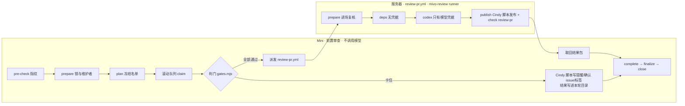

# Mivo 拆分运行胶水

Mivo（`xindong/mivo-canvas-plugin`）的 PR 审查使用 Cindy `review-pr-auto --review-only` 的流程，
拆成两段运行：



| 目录 | 内容 |
|---|---|
| `lib/gates.mjs` | 判门顺序（照 pr-worker：凭证 → 维护者确认门 → thread → 受保护路径/格式/CI/冲突/bot/rebase → 送审）与确认 issue 文案。改界面不进维护者确认门；缺界面证据（截图/录屏或 HTML）由 context 记进格式门打回；「效果展示」第一行写「不涉及」也算过 |
| `lib/scope.mjs` | 增量复审范围（方案第 8 节）：逐文件比较 PR patch，带全量兜底 |
| `lib/report.mjs` | 答卷校验、最终报告、发布前脱敏 |
| `lib/prompt.mjs` | 审查任务书：规范原文取自本仓 `review-pr/SKILL.md` 第 5 节、pr-worker 第 3 节、rule-map |
| `server/review.mjs` | 服务器四阶段：prepare / deps / codex / publish |
| `server/codex.mjs` | Codex CLI 调用：凭据只进 CLI 进程，子进程环境从零构造，产物去掉 key |
| `prereview/round.mjs` | Mini 一轮的主流程 |
| `prereview/gh-dryrun/` | dry-run 模式的 gh 垫片：读放行，写一律拦下 |
| `prereview/install-mini.sh` | 在 Mini 上部署/升级一个实例（launchd 每 180 秒） |
| `config/sandbox-pr-rules.json` | E1 沙箱仓用的配置 |

## 严重度

服务器审查的任务书（`lib/prompt.mjs`）按维护者 2026-10-12 的决定使用统一分级，覆盖 `review-pr/SKILL.md` 第 5 节的「严重度」段：只报确认成立的 P0（大范围灾难性影响）与 P1（受支持场景中可信可达的触发路径导致核心流程失效、严重数据错误或安全/隐私边界被突破）；规范原文里「记 P1」的具体条款按实际影响重新分级，P2/P3 不报、不阻断。

## 每天的运维

和老审查机用同一套机制、同一个时间表。两套跑在 L20-1 的同一批 runner 用户上，共用同一个工具目录和同一个 codex 二进制，所以服务器上的定时器是同一份，不另装：

| 时间（Asia/Shanghai） | 动作 | 新审查机怎么配合 |
|---|---|---|
| 06:00 | `mivo-review-close-seats.timer`：marker 改成 unhealthy，等所有 `gha-mivo-review-N` 上在跑的任务退出（新审查机的任务也在里面） | Mini 不开新一轮，也不派新审查；在途的审查跑完 |
| 06:05 | `mivo-review-cli-update.timer`：更新 CLI（sha256 校验、旧版备份、自检、模型探活、失败回滚、写 marker、连续 3 次失败告警） | 共用更新结果 |
| 07:00 | 不调度：时钟出了窗口且 marker 健康就开门 | 服务器 `prepare` 与上模型前各查一次窗口和 marker（对应老 gate 的两次检查）；Mini 07:00 起照常采集，窗口里来的 PR 自动补审 |

判据在 `lib/health.mjs`，逐条照搬 Mivo 的 `.github/scripts/review_tool_health.py`：06:00–06:59 关门；marker `status=healthy` 且有 `run_id` 才放行；缺文件放行；读不到按不健康；超过 26 小时没更新只告警不拦。没通过时，服务器不调模型，这次派发不算一次失败的尝试；工具链不健康时，Mini 暂停派发 30 分钟再试。

## 三种模式

| 模式 | Mini | 服务器 |
|---|---|---|
| `dry-run` | 判门、派发都照做，**任何 GitHub 写入都被垫片拦下**，打算做的动作记在结果的 `dryRunActions` | 完整审查，只上传结果包，不写 PR、不写 check |
| `sandbox` | 对沙箱仓真实写入 | 对沙箱仓真实写入；check `review-pr` 由沙箱仓的检查镜像 workflow 写（`GITHUB_TOKEN` 只能写本仓，见 `lib/checks.mjs`） |
| `live` | 对 Mivo 真实写入 | 发 review、开 thread、写 check `review-pr`、挂 `review:merge-ready` |

服务器允许的最高模式由 Mivo 仓库变量 `MIVO_REVIEW_MODE` 决定。

## 部署

服务器（全部经 GitHub 设置，不登录服务器）：

- 仓库变量：`MIVO_REVIEW_SKILL_SHA`（本仓提交，Mini 与服务器必须一致）、`MIVO_REVIEW_MODE`、
  `MIVO_REVIEW_SANDBOX_REPO`、`MIVO_REVIEW_DAILY_CAP`、`MIVO_REVIEW_RUNNER_LABEL`（切换前 `mivo-review-next`）、
  可选 `MIVO_REVIEW_MODEL_*` / `MIVO_REVIEW_EFFORT_*`；
- secrets：`MIVO_REVIEW_BOT_TOKEN`（发布用）、`LITELLM_CREDENTIALS_JSON`（模型网关）。

Mini：

```bash
bash ~/mivo-prereview/skill/mivo/prereview/install-mini.sh --sha <SHA> --instance mivo \
  --target-repo xindong/mivo-canvas-plugin --mode dry-run --workflow-ref main
```

日志在 `~/Library/Logs/mivo-prereview/<实例>/`，每轮一行 JSON。
