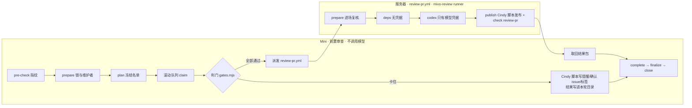

# Mivo 拆分运行胶水

Mivo（`xindong/mivo-canvas-plugin`）的 PR 审查使用 Cindy `review-pr-auto --review-only` 的流程，
拆成两段运行：



| 目录 | 内容 |
|---|---|
| `lib/gates.mjs` | 判门顺序（照 pr-worker：凭证 → 维护者确认门 → thread → 受保护路径/格式/CI/冲突/bot/rebase → 送审）与确认 issue 文案。改界面不进维护者确认门；缺界面证据（截图/录屏或 HTML）由 context 记进格式门打回；「效果展示」第一行写「不涉及」也算过 |
| `lib/scope.mjs` | 增量复审范围（方案第 8 节）：逐文件比较 PR patch，带全量兜底；任务书版本（`specDigest`）变了才因「规则变了」退回全量，审查机代码换版本不算 |
| `lib/report.mjs` | 答卷校验、最终报告、发布前脱敏 |
| `lib/prompt.mjs` | 审查任务书：规范原文取自本仓 `review-pr/SKILL.md` 第 5 节、pr-worker 第 3 节、rule-map。增量轮有一条优先规则：复审只看本轮变化的文件、上一轮的问题和它们直接影响到的路径，不再对完整 diff 做最终复核（维护者 R14「复审只审 diff」、2026-10-14「复审只看新改动」）。`specDigest` 由同一份确定性清单算出：固定模板与分级、选档说明、规范原文、rule-map、所有 PR 必读的文件、按改动路径命中的规则文件（都按 PR head 取）、生效配置与答卷 schema |
| `lib/deferrals.mjs` | 审查问题转 issue 跟进：解析 PR 说明里的登记、核验 issue、汇总 |
| `server/review.mjs` | 服务器四阶段：prepare / deps / codex / publish |
| `server/codex.mjs` | Codex CLI 调用：凭据只进 CLI 进程，子进程环境从零构造，产物去掉 key |
| `lib/admission.mjs` | 滚动接单的判断：什么时候另开一轮、哪些 PR 不进新一轮、held PR 什么时候唤醒 |
| `prereview/round.mjs` | Mini 前置审查主流程（一个进程可以同时推进多轮） |
| `prereview/admit-candidates.mjs` | 滚动接单用的候选名单（去掉未完成轮次里的 PR 及依赖它们的 PR） |
| `prereview/gh-dryrun/` | dry-run 模式的 gh 垫片：读放行，写一律拦下 |
| `prereview/install-mini.sh` | 在 Mini 上部署/升级一个实例（launchd 每 180 秒） |
| `config/sandbox-pr-rules.json` | E1 沙箱仓用的配置 |

## 严重度

服务器审查的任务书（`lib/prompt.mjs`）按维护者 2026-10-12 的决定使用统一分级，覆盖 `review-pr/SKILL.md` 第 5 节的「严重度」段：只报确认成立的 P0（大范围灾难性影响）与 P1（受支持场景中可信可达的触发路径导致核心流程失效、严重数据错误或安全/隐私边界被突破）；规范原文里「记 P1」的具体条款按实际影响重新分级，P2/P3 不报、不阻断。

## 审查问题转 issue 跟进

维护者 2026-10-14 决定：审查出的 P1，作者确认本 PR 修不了、要在后续 PR 里修时，可以转成 issue 跟进。登记好以后，这条 P1 不再阻断本 PR；没有别的 P0/P1 时，审查机照常 Approve。P0 不能转。

作者怎么做：

1. 开 issue：写清是哪个问题、现在有什么风险、打算怎么修；标题或正文提到本 PR（`#<PR 号>` 或 PR 链接）。issue 由 PR 作者或维护者开，保持 OPEN。
2. 在 PR 说明里加一节，标题一字不差：`## 转 issue 跟进的审查问题`（`##` 到 `####` 都行）。每个问题一行，写 issue 引用和一句说明，例如 `- #1001 旧 ghost 列表静默漏列`。只认本仓 issue，最多 10 项。
3. 在审查机原来那条讨论里回复 issue 链接，然后 resolve。前置门要求讨论全部 resolve 才送审；只剩审查机自己的 Request Changes、讨论都已 resolve 时，Mini 会对当前 head 重审。

审查机怎么判：

- 服务器 `prepare` 逐条读 issue，只采用同时满足这些条件的：在本仓（没被转移）、是 issue 不是 PR、OPEN、开 issue 的人是 PR 作者或维护者、标题或正文提到本 PR。没采用的写进报告并说明原因。
- 任务书只列采用的 issue。审查模型只能把和它们是同一问题（同一根因、同一触发路径）的 P1 标成 `deferredTo`；对不上或拿不准的照常阻断。`publish` 再核一遍：P0、或 issue 不在采用名单里的，照常阻断。
- 转 issue 的 P1 不开 thread、不阻断。没有其他 P0/P1 时照常 Approve、check `review-pr` 写 success、挂 `review:merge-ready`。报告单列「已转 issue 跟进的问题（不阻断本 PR）」，check 标题写明几条 P1 已转 issue。这不是免审：问题照样写在报告里。
- 打回时，只要阻断问题里有 P1，报告结论下面会附上这套做法。
- issue 关闭或从 PR 说明里删掉登记后就不再算。上一轮有转 issue 的问题时不沿用上一轮结论，每次重审都重新核验；已经发出的 Approve 要等下一次重审才会变。放行后加 `review:merge-ready` 标签会触发一次增量重审，这是已知代价。

## 每天的运维

和老审查机用同一套机制、同一个时间表。两套跑在 L20-1 的同一批 runner 用户上，共用同一个工具目录和同一个 codex 二进制，所以服务器上的定时器是同一份，不另装：

| 时间（Asia/Shanghai） | 动作 | 新审查机怎么配合 |
|---|---|---|
| 06:00 | `mivo-review-close-seats.timer`：marker 改成 unhealthy，等所有 `gha-mivo-review-N` 上在跑的任务退出（新审查机的任务也在里面） | Mini 不开新一轮，也不派新审查；在途的审查跑完 |
| 06:05 | `mivo-review-cli-update.timer`：更新 CLI（sha256 校验、旧版备份、自检、模型探活、失败回滚、写 marker、连续 3 次失败告警） | 共用更新结果 |
| 07:00 | 不调度：时钟出了窗口且 marker 健康就开门 | 服务器 `prepare` 与上模型前各查一次窗口和 marker（对应老 gate 的两次检查）；Mini 07:00 起照常采集，窗口里来的 PR 自动补审 |

判据在 `lib/health.mjs`，逐条照搬 Mivo 的 `.github/scripts/review_tool_health.py`：06:00–06:59 关门；marker `status=healthy` 且有 `run_id` 才放行；缺文件放行；读不到按不健康；超过 26 小时没更新只告警不拦。没通过时，服务器不调模型，这次派发不算一次失败的尝试；工具链不健康时，Mini 暂停派发 30 分钟再试。

## 审查失败后怎么重试

规则在 `lib/retry.mjs`，记录在 Mini 状态目录 `reviews.json` 每个 PR 的 `failures`（按 head）。服务器审查失败（`outcome=error`、超时取消、没有结果包、结果对不上）后，同一个 head 等 10 分钟再派，之后每次翻倍，最多等 4 小时；同一个 head 失败满 6 次停止自动重试，派发次数超过 9 次（`review-pr.yml` 守卫的上限）也停。成功一次就清零；作者推新提交是新 head，重新计数。维护窗口与工具链不健康不算失败。被拦住时 Mini 日志写 `retry-held`。

要在不推新提交的情况下重新审：在 Mini 上把该 PR 在 `state/<实例>/mivo/reviews.json` 里的 `failures` 删掉（或删掉对应 head 那一项），下一轮就会派发。

## 并发与滚动接单

- 全进程「在审」（已派发、还没收回结果的服务器 run，GitHub 上 queued 或 in_progress 都算）不超过配置的 `maxParallel`（上限 10）。每次领取任务前都先查全局在审数，满了就不领取。
- 已有轮次在等服务器审查时，每 3 分钟检查一次；同时满足下面几条才另开一轮：没有暂停（`pause.json`）、不在 06:00–07:00 维护窗口、进程运行不满 60 分钟、没有轮次还积压着未领取的任务、有空槽。
- 同一个 PR 不会同时进两个未完成的轮次；依赖在审 PR 的 PR（round-state 里的 `dependencyPrs`，按传递关系）一起延后。
- 维护者确认 issue 有新留言（Slack 放行）时，在审 PR 先不唤醒，等它所在那一轮结束后的检查点再唤醒。
- 进程运行满 60 分钟，或检出了新的 skill SHA、某一轮失败、接单时 plan 失败，就不再接新轮；手上的轮次跑完就退出，launchd 用新代码、新日志文件重新拉起。
- 某一轮失败时，如果它手里还有已派发、没收回的服务器 run，这些槽位没人释放：其余轮次停下、不收尾，整个进程退出，launchd 重新拉起后一起恢复。失败的那一轮手里没有在途 run 时，只停止接新轮，其余轮次照常跑完。
- 中断后下次启动，所有未完成的轮次一起接着跑：先把每一轮已派发的 run 都登记进在审数，再开始领取新任务。
- 日志事件：`plan`（接单开的轮次带 `admitted: true`）、`admit-skip`、`admit-none`、`admit-error`、`admit-plan-error`、`admission-closed`、`resume-rounds`、`round-failed`、`rounds-aborting`、`round-aborted`、`watch-restart`、`wake-held-deferred`。

## 三种模式

| 模式 | Mini | 服务器 |
|---|---|---|
| `dry-run` | 判门、派发都照做，**任何 GitHub 写入都被垫片拦下**，打算做的动作记在结果的 `dryRunActions` | 完整审查，只上传结果包，不写 PR、不写 check |
| `sandbox` | 对沙箱仓真实写入 | 对沙箱仓真实写入；check `review-pr` 由沙箱仓的检查镜像 workflow 写（`GITHUB_TOKEN` 只能写本仓，见 `lib/checks.mjs`） |
| `live` | 对 Mivo 真实写入 | 发 review、开 thread、写 check `review-pr`、挂 `review:merge-ready` |

服务器允许的最高模式由 Mivo 仓库变量 `MIVO_REVIEW_MODE` 决定。

## 部署

服务器（全部经 GitHub 设置，不登录服务器）：

- 仓库变量：`MIVO_REVIEW_SKILL_SHA`（本仓提交，Mini 与服务器必须一致）、`MIVO_REVIEW_MODE`、
  `MIVO_REVIEW_SANDBOX_REPO`、`MIVO_REVIEW_DAILY_CAP`、`MIVO_REVIEW_RUNNER_LABEL`（切换前 `mivo-review-next`）、
  可选 `MIVO_REVIEW_MODEL_*` / `MIVO_REVIEW_EFFORT_*`；
- secrets：`MIVO_REVIEW_BOT_TOKEN`（发布用）、`LITELLM_CREDENTIALS_JSON`（模型网关）。

Mini：

```bash
bash ~/mivo-prereview/skill/mivo/prereview/install-mini.sh --sha <SHA> --instance mivo \
  --target-repo xindong/mivo-canvas-plugin --mode dry-run --workflow-ref main
```

日志在 `~/Library/Logs/mivo-prereview/<实例>/round-<UTC 日期>.jsonl`，每个事件一行 JSON。
