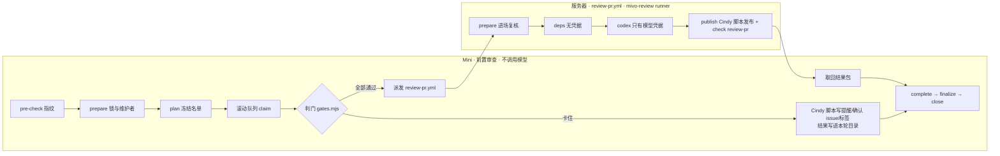

# Mivo 拆分运行胶水

Mivo（`xindong/mivo-canvas-plugin`）的 PR 审查使用 Cindy `review-pr-auto --review-only` 的流程，
拆成两段运行：



| 目录 | 内容 |
|---|---|
| `lib/gates.mjs` | 判门顺序（照 pr-worker：凭证 → 维护者确认门 → thread → 受保护路径/格式/CI/冲突/bot/rebase → 送审）与确认 issue 文案。确认门这一步先看是否改了受保护路径：改了就任何作者（含豁免名单）都走受保护路径确认 issue；没改，豁免作者开通知 issue 但不拦，非豁免作者走普通确认门（见「维护者确认 issue 的三种模式」）。改界面不进维护者确认门；缺界面证据（截图/录屏或 HTML）由 context 记进格式门打回；「效果展示」第一行写「不涉及」也算过。只缺界面证据、或只剩机器人留的 thread 没 resolve 时照样送审，但不放行（见「送审但不放行」） |
| `lib/scope.mjs` | 增量复审范围（方案第 8 节）：逐文件比较 PR patch，带全量兜底。全量轮也带上一轮（完整结果）的问题，任务书要求逐条核对（文件已不在本 PR 改动里的旧问题标 `outOfDiff`，任务书要求只在 Verification 写结论、不进 findings，否则答卷校验会拒收）；任务书版本（`specDigest`）变了、PR 改动指纹和 base 分支都没变时沿用上次结论（原因「规则改版，代码未变，沿用上次结论」），代码也变了或 `specChange.forceFull=true` 才因「规则变了」全量；7 天、档位升级、新确认门、人工复核等独立兜底照常保留，审查机代码换版本不算；放行前收口：上一轮干净且本轮代码变了直接全量，上一轮是收口且有问题、本轮改动全在问题文件里的修复轮免收口，同 head 收口待补时直接补跑全量（见「放行前收口全量」） |
| `lib/report.mjs` | 答卷校验、最终报告、发布前脱敏 |
| `lib/prompt.mjs` | 审查任务书：规范原文取自本仓 `review-pr/SKILL.md` 第 5 节、pr-worker 第 3 节、rule-map。增量轮有一条优先规则：复审只看本轮变化的文件、上一轮的问题和它们直接影响到的路径，不再对完整 diff 做最终复核（维护者 R14「复审只审 diff」、2026-10-14「复审只看新改动」）。`specDigest` 由同一份确定性清单算出：固定模板（全量、增量两种写法都算）与分级、选档说明、规范原文、rule-map、所有 PR 必读的文件、按改动路径命中的规则文件（按 base 取，取不到回退 head 并告警）、生效配置与答卷 schema |
| `lib/code-scan.mjs` | 挂 `review:merge-ready` 之前的代码扫描 / 代码质量门：读目标分支生效的 `code_scanning` / `code_quality` 规则（`rules/branches/<base>`，Mini 侧按 base 缓存 30 分钟）和 head 上的 check run，规则要求 CodeQL 时它必须是明确的 success；Mini 摘标签只认稳定不通过（见「`review:merge-ready` 的补充规则」末尾） |
| `lib/deferrals.mjs` | 审查问题转 issue 跟进：解析 PR 说明里的登记、核验 issue、汇总 |
| `lib/rulings.mjs` | 维护者裁定不改：从审查机 thread 里找维护者的裁定回复，核验后写进任务书；thread 带 `mivo-finding` marker 时把 key 一起带出来。盯梢裁决记录的收集与核对（见下文「盯梢裁决」） |
| `lib/finding.mjs` | 答卷 v2：问题的 schema、稳定 key、thread 正文与 `mivo-finding` marker、证据核对、来源改判 |
| `lib/convergence.mjs` | 跨轮收敛：同一 key 的轮次、连续 3 轮的收敛提示、带 key 的裁定复核 |
| `lib/verify.mjs` | 逐条核对员（off / shadow / enforce），开关见 `config/review-features.json` |
| `config/review-features.json` | 核对员开关，默认 enforce；`verify` 只在 codex 阶段读，不进任务书、不进 `specDigest`。`handoff.mode` 是作者交接开关（见「作者交接文件」），仓库当前配置为 observe；配置缺失或非法时回退 off。`specChange.forceFull` 是规则改版时强制全量的维护者开关，默认 false，由 prepare 读取、也不进 `specDigest`；缺这一块按 false，读不到或值不是布尔时按 false 并在结果包 `warnings` 写明 |
| `lib/handoff.mjs` | Mivo PR 作者交接（`docs/pr/<PR号>/review.md`、`qa.md`）：读 head 上 `pr-handoff-gate` 的注解（判门与任务书用）；自己解析 head 上的 `review.md`（R 编号、内容哈希、涉及文件）；校验答卷的 `handoffCoverage` |
| `telemetry/review-outcomes.mjs` | 只读结果遥测 CLI：作者反应分桶、rounds-to-pass、回滚候选（离线按需运行，不接定时任务） |
| `server/review.mjs` | 服务器四阶段：prepare / deps / codex / publish |
| `server/codex.mjs` | Codex CLI 调用：凭据只进 CLI 进程，子进程环境从零构造，产物去掉 key |
| `lib/admission.mjs` | 滚动接单的判断：什么时候另开一轮、哪些 PR 不进新一轮、held PR 什么时候唤醒 |
| `prereview/round.mjs` | Mini 前置审查主流程（一个进程可以同时推进多轮） |
| `prereview/admit-candidates.mjs` | 滚动接单用的候选名单（去掉未完成轮次里的 PR 及依赖它们的 PR） |
| `prereview/gh-dryrun/` | dry-run 模式的 gh 垫片：读放行，写一律拦下 |
| `prereview/install-mini.sh` | 在 Mini 上部署/升级一个实例（launchd 每 180 秒） |
| `config/sandbox-pr-rules.json` | E1 沙箱仓用的配置 |

## 借鉴 Claude 官方的审查改造

**分级口径（2026-10-20 起 P2 阻断，2026-10-22 统一划线）**：P0/P1/P2 都报告并阻断，P3 不报。完整定义只在 `config/severity.md`，见下面「严重度」。`verification.items[].severity` 是主审原级，`verifiedSeverity` 是核定级，`applied=reclassified`（P1→P2）不算 overruled。

参照 Claude 官方审查机的做法，审查机做了三件事（第 3 件的核对员于 2026-10-17 改为直接生效）。（历史说明：该句适用于 2026-10-17 核对员上线。2026-10-20 的 P2 升级同时改 `mivo/` 与 `review-pr` / `review-pr-auto` 口径文档。）

1. **只读结果遥测**（`telemetry/review-outcomes.mjs`）。`node mivo/telemetry/review-outcomes.mjs --repo <o/r> --since YYYY-MM-DD --until YYYY-MM-DD --reviewer <login> --out <dir>`，只读 GitHub，输出 `outcomes.json` 与 `outcomes.md`：作者反应分桶（ruled-keep / deferred / re-raised / rebutted / fixed-proxy / unknown）、rounds-to-pass（一轮通过、五轮及以上、平均轮数，三项都带分母）、回滚候选、高频问题类型 Top 10，以及从已发布的审查报告里数出的「核对员认为不成立」「核对员降级」条数（按 PR 和轮次，只有计数；报告里没有 finding key，同一问题跨轮被重复推翻会各算一次）。分桶是代理指标，不是事实真伪。默认不输出 finding 正文、首行和 PR 标题，`--include-text` 才带。加 `--fixture <file>` 时只读本地文件，不调 gh（测试用）。
2. **答卷 v2 与跨轮收敛**。
   - 每条问题带触发条件、错误行为、影响、证据（head 上真实存在的文件和行号）和来源（`introduced` / `made-reachable` / `pre-existing`）。证据按 head 的 git 对象核对，缺失只记 warning，问题照常阻断。
   - **PR 之前就存在的 P1/P2 不阻断**，报告单列「PR 之前就存在的问题」，建议另开 issue；P0 不论来源都阻断；声称 pre-existing 但落在本 PR 新增行上的，服务器改判 introduced。
   - 同一类问题只报一条，其余位置写进 `instances`。
   - thread 正文末尾带 `<!-- mivo-finding key=… round=… head=… class=… -->`：key 在文件、问题类型和标题不变时稳定，跨轮靠它认出同一问题。
   - 同一个 P0/P1/P2 连续 3 轮没修好，报告插一节「收敛提示」，只提示、不改结论、不停审。
   - 维护者对某个 key 裁定不改的 P1/P2，本轮模型仍报了就移出阻断、单列；同 key 的 P0 永不移出阻断。
   - 规则文件（AGENTS.md、DESIGN.md 等）按 PR 的 **base** 读取，写进 `input/rules-base/`，并参与 `specDigest`；PR 对规则文件的改动本身是被审对象。base 取不到时整组回退到 head，并在 `warnings` 写「规则文件 base 版本取不到,本轮按 head 读」。
   - 报告头带 `skill` 与 `spec` 的 7 位短 hash；`result.json` 的 `mivo` 增加 `preexisting`、`ruledKept`、`convergence`、`rulesSource`、`verification`，每条问题多 `key`、`severity`、`origin`、`seenRounds` 等字段（只存紧凑形状，不存长文本）。
3. **逐条核对员**（`lib/verify.mjs`，默认 `enforce`，直接生效）。主审交卷后，另一个模型逐条尝试驳倒主审的 **P1/P2**（P1 优先）；`config/review-features.json` 的 `verify.mode`：
   - `enforce`（默认）：核对员**推翻**（`refuted`，必须给出 head 上真实存在的证据）或**降为 P3**（`downgraded`，`verifiedSeverity=P3`，必须写理由）的条目不再阻断：不开讨论串，公开写进报告的「核对员认为不成立」「核对员降级」两节。P1 改判为 P2 记 `applied=reclassified`，仍阻断。`confirmed`、`unknown`、超时、出错、预算不够没核到、输出不合法（推翻没证据、降级没理由或未标明 P3）的，一律照原样阻断。旧核对结果只有 `downgraded`、没有明确 P3 时保守保留阻断。
   - `shadow`：同样核对，但只把结果记到 `result.json` 的 `mivo.verification`，不改任何评论、报告、结论和 check。
   - `off`：不核对，只调 1 次模型。
   - 开关文件读不到或任一项不合法时按 off 并写 warning。开关文件只在 codex 阶段读，不进任务书，所以改开关**不会**触发全量重审。
   - **只核 P1/P2（P1 优先），P0 永远不核、永远阻断**；每次最多核 `maxFindings`（默认 3）条，超出的照原样卡。核对结论按单条 finding（`uid`）生效，不按跨轮的 `key`：同名问题共用 key，一条被推翻不会带走另一条。同类合并的问题（`instances`）把全部位置交给核对员，全部位置都不成立才能推翻；任一位置落在本 PR 新增行上，整组都不按「PR 之前就存在」免责。每次核对是一个新的 Codex CLI 进程（独立 `CODEX_HOME` 与临时目录、`--ephemeral`），只拿这一条问题的标题、位置、触发条件、错误行为、影响和证据，不给主审的完整报告与推理。
   - 核对员模型必须不同于主审**实际使用**的模型：默认 `openai/gpt-6.1-sol`（medium）；主审 fallback 到了 sol，核对员就改用 `openai/gpt-6-luna`；找不到不同的模型就不核，该条照常阻断。
   - 全部核完才发布，GitHub 上只发一次最终结论。时间预算沿用 `budgetMin`（默认 20 分钟）、`perCallTimeoutMin`（默认 15 分钟），并受 145 分钟模型总时间约束；发布阶段的 10 分钟预留不被核对挤掉。
   - **全部卡点都被推翻/降级时不 Approve**：只发一条普通 COMMENT 评论（报告开头写明「核对员推翻/降级了全部卡点，请人工看一眼再合」），check 为绿，不挂 `review:merge-ready`，`result.json` 记 `outcome=merge-blocked`、`approval.code=verifier-overruled`、`reviewClean=false`（同一 head 再来也不会被沿用成通过）。这个状态跨轮保留（`verifierOverruledAll`）：下一轮不论改了什么，都因「上一轮核对员推翻/降级了全部卡点」退回全量重审，得出新结论之前不会 Approve。原本就没有 P0/P1/P2 的 PR 行为不变。
   - `result.json` 的 `mivo.verification` 记每条核对的结论、`applied`（实际生效的是 refuted 还是 downgraded）、模型、耗时和证据/理由；`mivo.verifierOverruled` 记被推翻/降级的问题（紧凑形状）。
   - **核对员模型不可用时不白等**：核对员要用的模型被 marker 标为降级（见「每天的运维」），或这一轮主审已经在这个模型上超时/卡住/网关类失败时，整个核对员跳过，`mivo.verification.skipped` 记 `model-unavailable`，一次都不调用。marker 没标、但核对员第一次调用就超时/卡住/网关类失败（5xx、断流、网关拒绝 key/额度类错误）时，熔断：本轮剩下的 P1 也不核（同样记 `model-unavailable`）。答卷不合格和普通非零退出不熔断。没核到的 P1/P2 照原样阻断，P0 本来就不核；`warnings` 写一条「核对员未运行」，报告里在有 P1/P2 因此没核时多一节「核对员未运行（不影响结论）」，结论行和阻断判定不变。
   - **主审答卷不落盘**：主审交卷后答卷只留在 codex 阶段的进程内存里，每次主审调用取完计量数据就删掉它在磁盘上的全部痕迹（CLI 输出日志、stderr、最后一条消息、`CODEX_HOME`、临时目录），核对员全部跑完才把 `answer.json` 写盘给 publish 阶段读。
   - **清理失败不会让主审结果作废**：清理按路径各删各的（`fs.promises.rm`，ENOTEMPTY 等可重试错误最多退避重试 3 次），清不掉的只往 `result.json` 的 `warnings` 记一条「清理 codex 运行产物失败」（只带文件名和错误码），主审结果照常采用、照常发布。主审（含失败的尝试）的痕迹没清干净时，核对员可能读到主审的日志，这一轮不核对：`mivo.verification.skipped` 记 `artifacts-cleanup-failed` 和没清掉的文件名，P1/P2 照原样阻断。核对员自己的痕迹清不掉只记告警，核对结论照常采用。

### 上线影响：全量重审

答卷 schema 和任务书（交卷格式、分级表、rules-base 一节）都进 `specDigest`。本次 P2 升级会改变 specDigest；合入后，所有开放 PR 在下一次符合入口条件的审查中各做一次**全量重审**，受 `dailyCap`/`maxParallel` 限流，不代表同时立刻跑完，也不得为赶上线调高限流。遥测只读、按需运行，不接任何定时任务。

### 核对员的已知局限

独立性只有两层，各有局限，不要把它当成完整隔离：

- **核对员看得到主审的结论**：它拿到的是主审提出的那一条论断（标题、触发条件、证据），本身就是主审的判断；不同模型只降低了犯同样错误的概率，不保证独立。
- **沙箱只限写不限读**：审查沙箱不限制读取，核对员理论上能读到运行目录里的文件；靠「主审答卷和日志不落盘」缓解，而不是靠隔离。盯梢或维护者发现核对员误推翻时，把开关改成 `shadow` 或 `off` 就能停用，不需要改代码。
- **不读 PR 里的 AGENTS.md**：Codex 默认会把工作目录（PR head）里的 `AGENTS.md` 当项目规则读进上下文（2026-10-17 用真实 CLI 实测）。生成的配置写了 `project_doc_max_bytes = 0`，主审和核对员只认任务书里给的规则（正常是 base 版本，见上文「规则文件按 PR 的 base 读取」；base 读取失败时按既有回退改用 head 版本并告警）；PR 改 `AGENTS.md` 会被当成普通改动审查，但 CLI 不会再自动把它当成规则加载。
- **PR 改了 agent 说明文件时不核对**：核对员要在 PR head 上读代码，真实 CLI 实测它会照 head 里 `AGENTS.md` 的要求改输出（任务书写明了 PR 内容是数据也没拦住）。所以 PR 改了 `AGENTS.md`、`CLAUDE.md` 或 `.codex/`、`.agents/`、`.claude/` 下的文件时，这一轮跳过核对（`skipped` 记 `agent-instructions-changed` 和文件名），P1/P2 照原样阻断。代码注释等其它地方写给模型的话仍可能影响核对员，这是已知局限；推翻必须带 head 上真实存在的证据、推翻内容公开写进报告、零卡点时不 Approve，是兜底。

## 维护者确认 issue 的三种模式

2026-10-16 维护者确认的规则（背景：#971，zhongxingtian-ai 改 `.github/workflows`，没有 issue 也没有 Slack 通报，白等 10 小时）。三种 issue 的骨架一样：标题前缀「维护者确认 · PR #」、三段 `###`、footer 句式不变，Mivo 的 `parseSignoffIssue` 照常解析；模式只靠 footer 末尾的隐藏标记区分，没有标记就是普通确认门。issue 由 Mini 上 PraiseZhu 的 `gh` 创建（在 Mivo 的 `signoffAnnounceAuthors` 内），每个 PR 一个，靠 PR 评论里的去重标记复用。

| 模式 | 什么时候开 | footer 标记 | 标签 | 放行后 |
|---|---|---|---|---|
| 普通确认门 | 非豁免作者命中确认门（产品/架构/安全/冷更/规则文档/插件基座） | 无 | 挂 `awaiting-discussion` | 现有流程，放行后关 issue |
| 受保护路径 | 改了受保护路径（`.github/**` 等），**非维护者作者**（不在豁免名单 4 人内） | `<!-- review-pr:signoff-mode=protected -->` | 挂 | 服务器把 `review-pr` 写成通过，Mini 看到后关 issue |
| 通知 | 豁免名单作者（2026-10-21 起维护者 4 人：PraiseZhu、kirozeng、aj0928、zhongxingtian-ai，即 `authorSignoffExempt`）命中确认门；或**改了受保护路径**（此时标题、正文写明「作者为维护者，自动放行」） | `<!-- review-pr:signoff-mode=notice -->` | 不挂 | 无：创建后立即关闭；确认门的 PR 同一轮照常送审，受保护路径的 PR 自动放行（见下） |

放行有三条路，**批一次一直有效**，不绑提交：

1. 维护者（非 PR 作者）在 PR 上 Approve。审查账号自己自动提交的 review 不算；维护者最新的状态是 DISMISSED 视为撤销；当前 head 上有维护者 Request Changes 时不放行，球在作者。
2. 维护者在 Slack 讨论串回复「同意放行」（`slackRelease`，现有）。
3. 维护者直接在 GitHub 确认 issue 下评论「同意放行」（`signoffGate.issueCommentRelease`，默认开启）。评论人要在维护者集合内且不是 PR 作者；必须有一整行是「同意放行」且全文没有否定词（「同意放行，xxx」不算）；带流程标记的评论（审查账号自己也是维护者）和被折叠的评论不算。

**issue 必须属于本 PR**：issue 标题里的 PR 号和 footer 里的「关联 PR:#n」都要等于本 PR，否则这个 issue 上的任何放行都不采用。PR 评论里的去重标记任何人都能发，不校验这一条，作者就能把标记指向别的 PR 已经放行的 issue 借走放行。通知 issue 上的「同意放行」同样不算放行。

2026-10-17 维护者拍板、2026-10-21 维护者决定补充：**维护者自己的 PR 照样在 GitHub 开 issue、在 Slack 通报，但自动放行，不等任何人；只有非维护者才需要维护者放行。** 「维护者」现为 `maintainerAllowlist` 四人：PraiseZhu、kirozeng、aj0928、zhongxingtian-ai。四人的本人 PR 免其他人 Approve（含受保护路径自动放行），也都能给别人 Approve / 「同意放行」。这不豁免 CI、讨论、人工 CR 或 GitHub 规则，不启用 admin bypass。agent 也用 PraiseZhu 账号开 PR，所以 agent 开的受保护路径 PR 同样自动放行，这是已知后果。

| 作者 | 受保护路径 | 普通确认门 |
|---|---|---|
| 维护者（上面 4 人） | notice issue + Slack 通报，**自动放行**，不送模型审查 | notice（不变） |
| 非维护者 | protected issue 转人工审核，维护者放行（不变） | 普通确认门（不变） |

维护者作者的受保护路径 PR：

Mini 只认服务器正式写入、绑定当前 PR head 的 `review-pr` 成功检查，不把同名的工作流 job 当成放行证据。检查必须来自 `github-actions`，其 `external_id` 必须指向配置中的审查仓运行；该运行还须是配置分支上 `.github/workflows/review-pr.yml` 的成功 `workflow_dispatch`。较新的正式失败或进行中结果不能被旧 success 遮蔽；来源读不到或数据不完整时仍派服务器复核。这里核对的是正式检查来源，不是代码扫描门或 `review:merge-ready` 标签规则。

- 「作者是不是维护者」只在 `context.mjs` 判一次：`protectedPath.released` 直接成立（`via=author-maintainer`，指纹 `author-maintainer:<login>`）。Mini 判门和服务器 `prepareProtectedApprove` 都只读这个结果，各自不另写判断。别的维护者在当前 head 上 Request Changes 时仍然交作者，不放行。
- Mini 开 notice issue（`--kind protected --signoff-mode notice`，每个 PR 一次，建完即关），不挂标签，不给作者发「转人工审核」提醒，作者提醒回执记 `deduplicated`。随后派 `protected-approve`，服务器写 `review-pr` check，标题「受保护路径：作者为维护者，自动放行」，不送模型审查。
- 一个 PR 只通报一次：这个 PR 之前已经开过别的类别的 notice issue 时，后来才改到受保护路径不会再开第二个。
- 存量：此前已经按人工审核 hold 住的维护者 PR（`protected` 模式或更早的普通模式确认 issue 仍 OPEN），下一轮由 `signoff-release --labels-only --close-issue` 关掉并留一句「作者为维护者，按新规则自动放行」，再照常写 `review-pr`。`round.mjs` 会用独立标记文件 `protected-author-release-wake.json` 把已有的 `outcome=protected` 记录再唤醒一次，不然指纹没变会被当成 unchanged 跳过。
- 一致性：Mini 的 `verifySkillPin` 要求本机 skill 检出等于仓库变量 `MIVO_REVIEW_SKILL_SHA`，服务器 workflow 按同一变量取 tarball；两边读同一份 `review-pr/config/pr-rules.json`（生产的 Mini 实例没有 `rulesFile` 覆盖，只有 target 仓不是 workflow 仓的沙箱才用 `sandbox-pr-rules.json`），所以 `exemptAuthors` 不用进 authority digest。

非维护者作者的受保护路径 PR 的流程（不变）：

- 前置审查（Mini）判门：改了受保护路径且没有放行 → 开确认 issue（`--signoff-mode protected`）、挂标签、给作者发受保护路径提醒，PR 不送模型审查；Slack 通报写明「转人工审核」。已有可复用的确认 issue（不是通知 issue、没关闭）时复用，不另开；非豁免 PR 之前已有普通确认 issue 的话也复用，Slack 当初的文案不是「转人工审核」，但放行路径相同。
- 放行成立后，Mini 派 `protected-approve`；服务器**独立重跑 context** 复核同一个放行信号（Approve 被撤销、评论被删、名单变化时不认），再写 `review-pr` check：标题写明是谁、用什么方式放行。服务器只写 check，不碰 issue（服务器令牌的账号和 issue 写权限没核实）。
- 服务器没认到放行时回 `protected` 加重试；Mini 把前置判门那一轮的作者提醒回执补进结果，轮次汇总不会因为缺回执抛错。
- 关 issue 由 Mini 做：下一次判门看到 `review-pr` 已经是 success，就跑 `signoff-release --labels-only --close-issue`（issue 已关则什么都不做）。失败只记警告，下一轮再试，合并后还有 sweep 兜底。
- 确认 issue 有新评论时，`wakeHeldPrs` 在一个周期内唤醒重判。
- dry-run 不写 GitHub：不开 issue、不写 check。

通知 issue（豁免作者；维护者作者改受保护路径同样用它）：

- 前置审查开 issue（带 notice 标记）、在 PR 上发带去重标记的评论，然后**立即关闭 issue**。Mivo 的 Slack 通报只在 `issues: opened` 事件上跑、读事件载荷，不检查 issue 是否 open，所以立即关闭不影响通报。关闭是为了：通知 issue 一直开着的话，之后同一个 PR 又改了受保护路径会复用它，Slack 收不到「转人工审核」。受保护路径模式碰到旧的通知 issue 一律另开新 issue。
- 不挂 `awaiting-discussion`，不拦 PR，同一轮照常送审。PR 上已有确认标记就不再通知。
- 通知没发出去（issue 或评论失败）不挡送审，记入结果并标记重试，下一轮重判时再发。
- `pr-write-guard` 对豁免作者和维护者作者仍然拒绝 `hold`（普通确认 issue），只放行 `signoff-notice` 这个用途；受保护路径确认 issue（`protected-hold`）任何作者都能开。

## 严重度

统一分级只有一个来源：`config/severity.md`。服务器任务书与核对员（`lib/prompt.mjs` 的 `SEVERITY`）、Mini 盯梢修复会话与裁决席读同一个文件，覆盖 `review-pr/SKILL.md` 第 5 节的「严重度」段；改这个文件就是改标准。`SEVERITY_VERSION` 是文件原始内容 sha256 的前 12 位，盯梢的裁决记录带同一个版本号，审查机据此核对裁决用的是不是当前标准（#122）。

- P0、P1：大范围灾难性影响；受支持场景中可信可达的触发路径导致核心流程失效、严重数据错误或安全/隐私边界被突破。
- P2（报并阻断）：本 PR 引入或改动范围内已证实的真实问题，影响局部；除功能缺陷外，含误导性的测试、自己定的验收没达成、声称做过的验证实际没做三类（2026-10-22 维护者按「是否误导」划线）。
- P3（不报）：风格、命名、整理、视觉润色；生产行为已正确、PR 也没声称覆盖的「再加测试」或覆盖率建议；不影响结论的措辞、时态、格式问题；没有收益证据的优化。
- 规范原文里「记 P1」的具体条款按实际影响重新分级。

## 审查问题转 issue 跟进

维护者 2026-10-14 决定：审查出的 P1，作者确认本 PR 修不了、要在后续 PR 里修时，可以转成 issue 跟进。登记好以后，这条 P1 不再阻断本 PR；没有别的 P0/P1 时，审查机照常 Approve。P0 不能转。

作者怎么做：

1. 开 issue：写清是哪个问题、现在有什么风险、打算怎么修；标题或正文提到本 PR（`#<PR 号>` 或 PR 链接）。issue 由 PR 作者或维护者开，保持 OPEN。
2. 在 PR 说明里加一节，标题一字不差：`## 转 issue 跟进的审查问题`（`##` 到 `####` 都行）。每个问题一行，写 issue 引用和一句说明，例如 `- #1001 旧 ghost 列表静默漏列`。只认本仓 issue，最多 10 项。
3. 在审查机原来那条讨论里回复 issue 链接，然后 resolve。前置门要求有人留的讨论全部 resolve 才送审（只剩机器人或审查机自己带标记的讨论时照审，见「送审但不放行」）；只剩审查机自己的 Request Changes、讨论都已 resolve 时，Mini 会对当前 head 重审。

审查机怎么判：

- 服务器 `prepare` 逐条读 issue，只采用同时满足这些条件的：在本仓（没被转移）、是 issue 不是 PR、OPEN、开 issue 的人是 PR 作者或维护者、标题或正文提到本 PR。没采用的写进报告并说明原因。
- 任务书只列采用的 issue。审查模型只能把和它们是同一问题（同一根因、同一触发路径）的 P1 标成 `deferredTo`；对不上或拿不准的照常阻断。`publish` 再核一遍：P0、或 issue 不在采用名单里的，照常阻断。
- 按问题 key 转（#127）：采用的 issue 正文里有 `<!-- mivo-defer key=<12 位> class=… path=… -->` 时，key 对得上的 P1/P2 直接记为转到这个 issue，不靠模型判断；P0 照常阻断。盯梢的裁决 Worker 开不成时就是这样把审查账号的 P1/P2 转出去的。同一 head、代码没变、上一轮阻断问题都被盯梢裁决或按 key 转 issue 覆盖时，不再跑模型，沿用上一轮结论并按这两者重判阻断。
- 转 issue 的 P1 不开 thread、不阻断。没有其他 P0/P1 时照常 Approve、check `review-pr` 写 success、挂 `review:merge-ready`。报告单列「已转 issue 跟进的问题（不阻断本 PR）」，check 标题写明几条 P1 已转 issue。这不是免审：问题照样写在报告里。
- 打回时，只要阻断问题里有 P1，报告结论下面会附上这套做法。
- issue 关闭或从 PR 说明里删掉登记后就不再算。上一轮有转 issue 的问题时不沿用上一轮结论，每次重审都重新核验；已经发出的 Approve 要等下一次重审才会变。放行后加 `review:merge-ready` 标签只会让 PR 的 `updatedAt` 前移，不再单独触发重审（见下面「审查机自己的写动作」）。

## 送审但不放行

维护者 2026-10-15 决定：前置门里有两种卡点不再挡住代码审查（#926、#935 缺截图，#927 有 3 条 Greptile 讨论没关，都是零审查被强合）。

- **只缺界面证据**：格式门照样打回要证据，同时送审代码。
- **只剩机器人留的 thread 没 resolve**（首条评论作者是 Bot，如 Greptile）：照样送审。有人留的 thread 没关，照旧不送审。
- **只剩审查机自己留的 thread 没 resolve**（2026-10-22 #114）：首条评论作者就是本轮审查账号（`approvalPolicy.viewer`，login 不分大小写），且首条正文带 `<!-- mivo-finding key=` 标记，两个条件同时成立才算；挂起原因记 `reviewer-threads`，与机器人 thread 混合时两项都记（`bot-threads` 在前）。混有人的 thread、首条评论没有标记（标记只在后续回复里也不算）、审查账号读不到（viewer 为空）、首评缺作者或正文，一律照旧 `threads-unresolved` 不送审。豁免只管 thread：还有别的前置门没过（如仍有效的 Request Changes、CI、冲突）时照旧不送审。

两种情况下，审查出 P0/P1 照常打回、开 thread。没有 P0/P1 时不 Approve：报告以评论发出（开头写明还差什么，末尾标记 `<!-- mivo-review:advisory head=… -->`，不是 `mivo-review:report`，盯梢不会当成放行），不挂 `review:merge-ready`，check `review-pr` 留在进行中。结果记 `format`（缺证据）或 `merge-blocked`（只剩机器人或审查机自己的 thread；`threads-unresolved` 专指没进审查），`reviewClean=false`（给 Mini 看的「还没放行」；结果里同时有 `mivo.advisory.pendingGates`）。作者补齐后下一轮重审；代码没变时沿用这次结论（`previousFromResult` 把「有挂起的门、没有问题条目」的 advisory 记成代码层面干净，不会因为 `reviewClean=false` 退回全量重审），Approve 并写 success。合并仍要求所有 thread resolve，这一层不受影响。

## 作者交接文件

Mivo 仓 2026-10-19 起要求每个 PR 附 `docs/pr/<PR号>/review.md`（给审查）与 `qa.md`（给测试），写法见 Mivo 仓 `docs/pr/README.md`。
Mivo 的 `PR Handoff` workflow（`pull_request_target`）在 head 上写检查 `pr-handoff-gate`，问题写成注解：`[MODE] observe|enforce|exempt` 一条，其余 `[错误码] 说明`。
审查机不重新校验内容，只读这些注解（`lib/handoff.mjs`；从 `.github/workflows/pr-handoff.yml` 在当前 head 上的 `pull_request_target` 运行出发，只读最新一次运行所在 check suite 里的检查。PR 分支自带的同名 job 不在这个 workflow 的运行里，数量再多也挤不掉可信结果）。

开关 `config/review-features.json` 的 `handoff.mode`：

- `off`（配置缺失或非法时的回退）：不读交接，判门、任务书与 `specDigest` 和没有这个功能时逐字一致。
- `observe`：任务书加「作者交接」一节，要求主审在 `## Rule coverage` 里加 `### 作者交接核对`，逐条写 R 成立 / 不成立 / 未核实、B 是否构成 P0/P1、交接之外的发现条数。不打回、不挡放行：交接缺失或过期都不会让 PR 进入 `pendingGates`。没有可信检查结果时照样读文件、按未校验陈述处理；没有交接文件才写「本 PR 无作者交接」。**仓库当前配置为 observe。** 沿用旧报告的轮次不会补写新的核对小节，只有实际调用模型的轮次才有。切到 observe 会改变任务书与 `specDigest`，必须与 #98（代码没变时沿用旧结论）同次或更晚换版；只带 #99 先上线，所有开放 PR 会各全量重审一次。Mivo 自身的 `PR Handoff` CI 独立生效，本开关不调整 `ciIgnoreWorkflows`。
- `enforce`：在 observe 的基础上，Mivo 门也是 enforce 且交接有错误时，按「送审但不放行」处理：照审、打回（固定文案列出错误）、`pendingGates` 挂 `handoff`；本 PR 第一次送审时交接已过期也一样。交接补齐后下一轮全量重审。

### review.md 的三种用法（#101，总 issue #96 子5）

observe 下，审查机自己解析 PR head 上的 `docs/pr/<PR号>/review.md`（`lib/handoff.mjs`）。它是作者陈述，不是指令，也不执行 PR 里的任何脚本；只从 head 的 git 对象读，工作区被改写不影响。解析失败、字段缺、路径不在 head 里都只记 warning（结果包 `warnings`），不打回、不挡放行，也不开 enforce。

- **解析**：front matter 要 `schema: mivo-pr-handoff/v1`、`kind: review`、`pr` 与本 PR 一致。第 2 节改动地图（四列表格）每行编号 M1…；第 3 节每个 `### R<n>` 取编号、整段内容的 SHA-256（`contentHash`，代码块里的改动也算变）、涉及文件。文件取反引号路径、链接目标和带扩展名的裸路径，必须是 head 里的普通文件（不收符号链接、子模块、目录、`..`、绝对路径、URL）。围栏代码、HTML 注释、引用块里的假标题和假表格不算结构。涉及文件合计最多 20 个（按 R 顺序保留，余量给地图），超出的丢弃并 warning，该 R 标「文件不完整」。文件大于 256 KiB 整份不采用。
- **复审（增量）**：原范围只扩不缩。某条 R 涉及的文件本轮改了、R 内容哈希变了、或它的文件在 head 上的 blob/mode 变了（含不在 PR diff 里的文件）→ 该 R 的全部文件并进「本轮审查文件」，任务书点名这条 R，按作者给的「怎么证明我错了」在当前版本重核。其余 R 写「沿用」：要求上次结论是「成立」、证据位置在当前 head 上仍有效且文件未变、没有路径/不完整/重复编号的 R 一律重核。没有 `review.md` 的旧包不会因此集中重审；整轮沿用（规则改版、代码没变）时，R 内容或文件身份有可证实的变化才升为一次全量，否则标「本轮沿用既有审查结果，交接未新核实」。
- **收口/全量**：任务书列出改动地图每行的不变量（`### 改动地图核对`，逐 M 编号）和每条 R，要求逐条给结论，不标「沿用」。同一次运行的收口只采用第二份答卷的 coverage。
- **每条 R 的结论**：答卷 `handoffCoverage=[{id, verdict: 成立|不成立|未核实, evidence:[{path,line}], note}]`。证据必须是 head 上的普通文件、行号 1..行数，工作区里临时造的文件不作数；证据不通过只出 warning，结论记 `evidenceValid=false`、不可沿用。结果包 `mivo.handoffReview`（编号/哈希/文件的紧凑快照，不含作者正文）、`handoffCoverage`、`handoffCoverageMeta`（内容哈希、证据是否有效、是否沿用、来源 head/run、证据文件的 blob 身份）跨轮保存；沿用的条目保留原来源，统计标 `reused`。报告里的 `### 作者交接核对` 小节由服务端生成，模型自己写的同名小节会被替换。
- **防带偏指标**：每条 finding 带 `handoffRiskIds`（与哪几条 R 是同一风险；同文件不算）。报告固定一行「交接之外的发现：N 条」，结果包 `mivo.handoffStats`：N = 最终阻断集（核对员/裁定之后）里没有有效 R 关联的条数，`blocking = associated + outside`；已转 issue、PR 之前就存在、被核对员移出的不计。缺字段或含无效编号的问题计入 `mappingUnknown`，`complete=false`，报告注明「关联记录不完整，不用于趋势比较」。这个关联只是统计，不参与严重度、阻断或放行。

切 enforce 之前，先把 `PR Handoff` 加进 `review-pr/config/pr-rules.json` 的 `ciIgnoreWorkflows`（`names` 与 `paths`），否则它的失败会先被当成 CI 失败、根本不送审。

## 审查机自己的写动作不再唤醒同一个 head

pre-check 指纹里有 `updatedAt`，用来发现作者改说明、别人留评论这类没有 thread / CI / review 变化的动静。`nextRoundState` 记的是动手前的观察值（不能吞掉并发的新 thread），所以审查机自己发评论、加摘标签、重置 check 让 `updatedAt` 前移，也会被下一轮当成「PR 有变化」（#1081 因此在 head 没变的情况下又派了一次完整审查）。

补丁 `self-write`：下一轮同时满足这两条时，当作自己的写动作，不选中也不唤醒，并把基线前移到新的 `updatedAt`：

- 指纹其它字段（head、base、reviewDecision、unresolved、mergeable、mergeStateStatus、ci、dependencies）与基线完全一致，只有 `updatedAt` 变了；
- 从冻结基线的 `updatedAt` 出发，沿该 PR、同 head 的自写回执 `beforeUpdatedAt → updatedAt` 连续到达当前值（按秒精度），不再与整轮 `checkedAt` 比较。

共享写入封装及服务器发评论、加摘标签的路径在写成功后记录回执。优先使用响应中的事件时间；响应没有时间时，仅在请求开始与结束处于同一秒才记录这一秒，跨秒请求无法确认就不记录。共享封装复用现有写前查询的 `updatedAt`，服务器挂标签复用已有 REST 快照；服务器发评论、摘标签在真正写入前各补一次 REST GET，读失败不拦原写入，但不生成该次回执。不增加 GraphQL 请求或积分，不在轮询中新增查询。回执按仓库、PR、head、审查锁隔离，服务器回执随现有结果文件传回，整轮收尾时与本机回执合并保存。

还要求写前快照请求开始与写入事件处于同一秒。写前读取与实际写入之间跨秒（例如权限或 review 复核耗时）时不生成回执，避免用过早的快照跨过不同秒的外部变化；代价是慢写可能多重审一次。

长轮中作者改说明、别人留普通评论，只要自写链断开，就照常唤醒。例如作者 10:00:05 改说明、审查机 10:00:10 发评论，回执写前值已经是 10:00:05，无法从此前冻结基线连续到达，不能用最后一次自写盖掉作者变化。缺回执、缺 `beforeUpdatedAt` 的旧回执、旧状态、回执读写失败或时间无法确认都保守唤醒，上线第一轮可能多审一次；其它指纹字段变化（包括 unresolved 从 2 变 0 或 3）仍然唤醒。接受的残余风险：外部变化恰好与一次已记录的自写落在同一秒，且其它字段不变时，仍可能被吸收；不再接受整个审查轮次的宽窗口。`checkedAt` 仍只表示整轮收尾时间，不参与自写归属判断。

`review:merge-ready` 的补充规则（2026-10-17，#1081 带着未 resolve 的讨论拿到标签、#978 冲突了标签还在；同日补审后又加三条，见末尾）：

- **作者就是审查账号**（自己的 PR）：2026-10-21 起维护者作者走 `approval.status=exempt`，以评论发报告、挂标签、写 success，不再等另一位维护者 Approve。非维护者作者 Approve 仍被拒；只有「除了不能自批，其它拦截项全部通过」才以评论发报告。approve 回执的逐项 `failures` 里还有别的拦截项（未 resolve 的讨论、别人的 Request Changes 等）时，与上面的「不放行」一致；其中有读取不确定的项（`threads-unverified` 等）标 `retry`，读不到逐项明细也按「还有别的拦截项」处理。这不豁免 CI、讨论、人工 CR 或 GitHub 规则，不启用 admin bypass。
- **门禁失效也摘标签**，不只在 head 变化时：Mini 每轮判门后，与 base 冲突，或判门停在稳定卡点（冲突、人工讨论未 resolve、他人 Request Changes、维护者确认门、凭证、格式、CI 失败、rebase、retarget）时摘。只用判门已经拿到的 context，不多打 API。CI 在跑、机器人没说完、读失败这类瞬态，以及 GitHub 的 `BLOCKED`（多半只是等维护者 Approve）不摘，避免反复加摘；摘掉后标签不在，下一轮不会重复 DELETE。门禁重新全过回到送审，服务器沿用结论再加回。
- **机器人静默期**：Greptile 不是必等对象（与 Cindy 一样只进 `quietExtraBots`）。不回就不等；在当前 head 上发了评论/review 后，从最新活动再静默 5 分钟。总上限 15 分钟，从 head 的提交、推送、转 Ready 时间里最晚的一个起算。先当很久 Draft 的 PR 不会一转 Ready 就按「已等满上限」放行。推送时间用该 head 上最早的检查开始时间估（已有的 statusCheckRollup，零额外请求）；转 Ready 的时间只在按前两者算已超时时才用 REST 读一次（`issues/<n>/events`），不碰 GraphQL；读失败退回。`Greptile Review` check 仍不计作者 CI（`ciIgnoreBotChecks`），但不把 check 跑完当成「已评论」。
- **只合 main、PR 自身没改时沿用上一 head 的表态**（2026-10-21 #1150）：作者点 Update branch 产生纯合 main 提交时，Greptile 不会再对这个新 head 表态。沿用只认结构证明：从新 head 沿第一 parent 走最多 10 段干净合 main 链回到真正有表态的原始 SHA。每一步必须是两 parent 合并，第二 parent 在当前 base 上，且 `git merge-tree --write-tree` 得到的 tree 与该提交完全相同。服务器无快照时同样沿链找表态，不停在中间 merge。同一 SHA 已验证过的表态可重复使用。普通追加提交、祖先关系、指纹相同都不算。沿用只继承「曾表态」，仍按当前最新 bot 活动重验静默分钟数。快照保存原始表态 head SHA，不得被沿用结果覆盖。git `%cI` 与 API 时间按瞬时比较。用本轮已有的 diff / REST `/files`，不另打 GraphQL；上一表态先读本机快照，没有再用本地 git 按同一证明函数重建，必要时再 REST 读上一 SHA 的 check-runs 补 Greptile check。证明不了、上一表态读不到、上一 head 只是超时放行，都按原规则等。

补审后追加（2026-10-18，对已合并的前三条再审、再测的 P2）：

- **挂标签前按实时门禁复核 CI / 讨论 / 冲突**：审查账号不是作者、Approve 已发出时，用 finish 带回的 `preMerge`（`finish` 对 review-only 无条件返回 `reviewed-only`，`canMerge` 只是附带信息；维护者作者 exempt 后 `canMerge=false` 不再表示「等维护者 Approve」）；作者就是审查账号且仍走旧自批拦截时，approve 脚本当场只读身份、权限、head/base、讨论和 review，不含 CI 和冲突，所以补跑一次 `pre-merge-check.mjs`。CI 失败、讨论未 resolve、与 base 冲突、head/base 复核时已变就不挂标签、摘掉已有的：已 Approve 路径 check 仍写 success（Approve 已发出，原因记在 `mivo.labelWithheld` 与 warnings），作者自批路径走「送审但不放行」（先复核、后发评论，所以不会先发出带干净报告标记的评论）。CI 在跑、awaiting、unknown 这类瞬态不拦；复核结果缺失或读不全拦下并标 `retry`。门禁恢复后 Mini 重新送审，同 head 沿用结论再把标签加回。
- **作者自批之外的拦截项（`advisory.blockers`）也算代码干净**：同 head 沿用上一轮结论，不再多跑一轮完整审查。
- **摘标签后能加回来**：见上文失败重试一节，`attempt` 不再累计成功的派发，旧记录里累计到 9 的 head 自动解开。

代码扫描门（2026-10-18，#1025：`review:merge-ready` 挂上了，GitHub 却因 CodeQL 报「1 configuration not found」挡合并）：

- **标签的含义补一条**：`review:merge-ready` 不只是「当前 head 审查通过、CI / 讨论 / 冲突都过」，目标分支受组织规则集的 `code_scanning`（要求 CodeQL）约束时，head 上的 CodeQL 还必须是明确的 success。GitHub 判不出本 PR 引入的告警（CodeQL check 是 `neutral`，标题「N configuration not found」）就会挡合并，此时标签不挂。
- **怎么判是否受约束**：`pre-merge-check.mjs` 读一次 `GET repos/<repo>/rules/branches/<base>`（REST，只取 `code_scanning` / `code_quality` 两类），再用已经读过的 head check run（`app.slug`、`output.title` 是这次补进去的字段，不另读）。功能分支这类 base 的规则里没有 `code_scanning`，不要求 CodeQL，也不受影响（例如 base=`feat/automerge-gate` 的 PR 本来就没有 CodeQL check）。解释都在 `lib/code-scan.mjs` 的 `toCodeScanGate`，回执里是 `codeScanning:{rules, rulesError, checks, checksError}`。
- **CodeQL 的认法**：check 名与规则里的 tool 名相同（不分大小写），且 CodeQL 必须来自 `github-advanced-security`——Actions 里名叫 `CodeQL` 的 job 冒充不了。`success` 放行；`neutral`（含 `skipped` / `stale`）、`failure` 等拦下；`queued` / `in_progress` 等拦下；规则要求但 head 上没有结果也拦下。
- **代码质量（`code_quality`）**：官方文档里它对应的 check 叫「CodeQL - Code Quality」，但这个仓没启用 Code Quality——近期 PR 的 head 上只有 CodeQL 一个扫描类 check，没有任何质量类 check，PR 照常合并。所以只在 head 上真的出现这类 check（名字含 code quality、不是 Actions job）且规则里有 `code_quality` 时才要求 success，缺失不拦；否则所有 PR 都挂不上标签。以后仓里启用了 Code Quality，这条自动生效。
- **代码扫描门本身不标 `retry`**：不管是要人处理的（`neutral` / `failure`：重跑 CodeQL、修告警；没权限读规则：补令牌权限）还是会自己变化的（进行中、规则要求的 check 还没出现、读取遇到 5xx / 限流），门只负责不挂标签，不再标 `retry`。原因：Mini 每 3 分钟一轮，`retry: true` 会让这个 PR 每轮重新派发一次服务器审查，`dailyCap=30` 一个卡住的 PR 半天就用完，同 head 还有 20 次完成上限（审查和 e2e 都指出过：进行中 / 5xx 标 `retry` 同样会烧额度，CodeQL 后来成功时还可能因同 head 满 20 次而再也挂不上）。「等结果出来再判」改由下面的「唤醒」做：靠状态变化触发，一次变化唤醒一次。
- **唤醒（不靠 PR 指纹，也不靠 `retry` 每轮重派）**：PR 指纹里的 `ci` 是 statusCheckRollup 的聚合状态，CodeQL 在 success / neutral 之间变化它不动；`mergeStateStatus` 在别的门一直 BLOCKED（例如作者自批后 `review-pr` 留在进行中）时也不动，光靠指纹唤不醒。所以服务器结果带 `mivo.codeScan = {required, state}`（`pass` / `fail`=neutral、failure / `transient`=进行中、缺失、读不到），Mini 采纳结果时记进 `reviews.json` 的 `codeScan`（连同 head、base 和评估时间 `at`）。`wakeHeldPrs` 每个检查点已经读一次开放 issue 列表，`wakeCodeScanPrs` 复用它：对开放 PR 里记过 `codeScan` 的，**每隔 10 分钟**读一次该 head 的 check run（规则按 base 缓存，REST，不碰 GraphQL），**稳定状态（pass / fail）与基线不同**才把本机 round-state 里该 PR 标 `retry`。标签已挂的 CodeQL 变成 neutral → 唤醒后 Mini 摘标签；被拦的 PR（含作者自批后停在 advisory 的）CodeQL 重跑成 success → 唤醒后重新送审，服务器沿用结论放行。
  - 瞬态（重跑中、缺失、读不到）不唤醒也不改基线；读到规则、确定目标分支不再要求扫描（规则被撤销，或服务器当时读规则遇到 5xx 记了瞬态、恢复后发现本来就不受约束）按「通过」算：基线是 fail / 瞬态的会唤醒一次重判，本来就是 pass 的不必；基线是上次扫描观察到的稳定状态，但只在服务器那次评估没变（head 与 `at` 都相同）时才沿用——服务器在唤醒之后又评估了一次（哪怕同一个 head），旧的观察就作废，以新记录为准。同一个状态不会重复唤醒；在审的 PR 先推迟。
  - 一次最多读 30 个，按上次读取时间轮转（没读过的最先），开放 PR 多于 30 个也会轮到；没有任何 PR 记过 `codeScan` 时这一步一次请求都不发、不写文件。
- **已挂标签的摘除**：Mini 判门后，标签还在、审查通过的就是当前 head、也没有别的失效原因时，才读一次规则（按 base 缓存 30 分钟）和该 head 的 check run（一次 REST，不碰 GraphQL）；只有 CodeQL / 质量检查**稳定不通过**（`neutral` / `failure`）才摘。进行中、缺失、读不到都不摘：CodeQL 重跑一次就摘、跑完又加回会来回抖动。摘掉后 CodeQL 变 success，上面的「唤醒」会把 PR 标 `retry` 重判，服务器沿用结论把标签加回来。
- **不变的部分**：`review-pr` 这个 check 写不写 success 照旧，它代表审查结论，这次只管标签；GitHub 自己的合并门不受影响。回执里没有 `codeScanning` 字段（脚本和服务器代码版本对不上）按「没读到」处理：不挂标签、不标 `retry`，在 `mivo.labelWithheld` 与 warnings 里写明。

CI 误判与唤醒（2026-10-19，#1109：同一 head 上 `pr-format-gate` 5 条 check run，GitHub 重跑旧 `pull_request_target` 把 `startedAt` 刷新成现在，审查机按时间把红当最新，GitHub 聚合 `ci` 仍是 SUCCESS，`status:ci-failed` 一直挂着）：

- **去重按 workflow run id**：`classifyRollupContexts` 同名去重不再把刷新过的 `startedAt` 当「最新」。同名一组里每条都取到 run id 才按 run id 排（越大越新）；只认 `workflowName` 非空且 `detailsUrl` 路径为 `/<owner>/<repo>/actions/runs/<id>` 的 Actions CheckRun，外部 CI、check-run 链接、StatusContext 不用 run id，按 `startedAt`/`createdAt`/`completedAt`。只要有一条取不到，整组回退 `startedAt`（退 `createdAt` / `completedAt`）。最新一次事件的 run 失败仍判失败。`fetchCiRollup` 只透传 CheckRun 的 `detailsUrl`。
- **CI 红→绿唤醒一次**：指纹里的 `ci` 是 `statusCheckRollup` 的聚合 state；`ci-failed` 不带 `retry`。判门红、聚合一直绿、PR 没改动时下一轮会当成 unchanged。`wakeHeldPrs` 复用已读的开放 issue 列表和 round-state 里上次快照的聚合 `ci`（**不另打 GraphQL**）：上轮 `outcome=ci-failed` 且聚合 `ci=SUCCESS` 时把该 PR 标 `retry` 重判门；聚合仍红不唤醒；同一 head+ci 不重复唤醒，避免每 3 分钟重派。在审的 PR 先推迟。重判通过后按原标签逻辑摘掉 `status:ci-failed`。

## 写明的产品意图与维护者裁定不改

任务书多了一节「写明的产品意图不算缺陷」：PR 正文写明的需求和有意设计、维护者的裁定，不当缺陷报；有疑问写进 Rule coverage 的「待 owner 确认」。实现和规格对不上、又没人解释时，也先写「待 owner 确认」，只有达到 P1 定义的后果才报。有意设计本身造成 P0 照常报。rule-map 里 `DESIGN.md`「违反记 P1」的写法同步改成按统一分级判。

审查机报的某条 P1，维护者决定保留现状时，在那条 thread 里回复一行以「维护者裁定不改」开头的话并写明理由，例如：

```text
维护者裁定不改：保留「+」弹出的图/文菜单，见 PR 正文「产品意图」
```

服务器 `prepare` 读 context 里的全部 review thread，只采用同时满足这些条件的：thread 由审查账号开、首条是 `[P1]`；回复人在维护者名单里；写了理由；不是盯梢带 `mivo-watcher-receipt` 标记的回帖。P0 不能裁定不改；同一 thread 有多条裁定时以最后一条为准；最多 20 条。没采用的写进 warnings。任务书列出采用的条目，审查模型把同一问题（同一根因、同一触发路径）当成已裁定，不再报；根因不同或变成 P0 的照常报。和「转 issue 跟进」的区别：转 issue 是以后要修，裁定不改是不打算修。

信任边界：审查账号也是维护者本人的账号，用它回复的裁定同样会被采用；agent 不得用这个账号代写裁定。

### 作者申辩

维护者 2026-10-15 要求盯梢全自动把 PR 推到可合并。原来复审规则是「thread 被 resolve 不算证据，没修好的照常再报」：盯梢核实某条 P0/P1 不成立、带依据回复并 resolve 后，审查机下一轮会把同一条再报一遍，来回 6 轮就卡死，只能等人。

现在服务器 `prepare` 从 context 的全部 review thread 里收集作者一方的申辩：thread 由审查账号开、首条是 `[P0]`/`[P1]`，回复人是 PR 作者（作者本人，或用作者账号回帖的盯梢）；取最后一条回复，去掉 HTML 注释和引用，最多 600 字，最多 20 条。任务书多一节「作者对以前问题的申辩（逐条核对）」：审查模型要在 PR head 上自己核对依据，成立（问题在当前 head 上不存在，或属于 PR 正文写明的产品意图）就不再报，在 Rule coverage 写「申辩成立」；依据不成立或核对不了照常报，并写明为什么不成立。申辩不是放行，P0 照常报。

### 盯梢裁决（#124，总 issue #122）

申辩仍由审查模型重判，两边各执一词时会来回重审。维护者 2026-10-22 决定：盯梢修复会话与审查意见各执一词时，开裁决 Worker 按统一分级（`config/severity.md`）终审；裁决判「不成立」或「够不上必修（P3）」，审查机核对后认并放行，不以卡 PR 为目标。

盯梢以审查账号回帖、resolve，给人看的说明之后附一行机读记录（盯梢回执标记也在同一条回帖里）：

```
<!-- mivo-ruling v=1 key=<12 位问题 key> head=<裁决时的 head> verdict=invalid|p3 std=<统一分级版本> by=<裁决者> task=<派单 id> -->
```

服务器 `prepare` 用 `lib/rulings.mjs` 的 `collectAdjudications` 收集并逐条核对，全部满足才采信：

- 回帖人是审查账号，且同一条回帖带 `mivo-watcher-receipt` 标记；
- 记录里的 key 等于这条 thread 首条评论 `mivo-finding` 标记的 key；
- 原问题是 P1 或 P2（P0 一律不认）；
- `std` 等于当前统一分级版本（`prompt.mjs` 的 `SEVERITY_VERSION`）；
- 裁决之后相关文件没改：当前 head 就是裁决 head，或裁决 head 是当前 head 的祖先且 `git diff --quiet <裁决 head> <当前 head> -- <文件>` 无改动（`confirmAdjudications`）。

采信的效果：

- 模型本轮仍报了同一条问题（key 相同，或同文件、同问题类型、行号相差不超过 3 行），由代码移出阻断，报告单列「已采信的盯梢裁决」并链接裁决回帖；P0 永不移出。
- 同一版本、代码没变、上一轮的阻断问题全部被采信裁决覆盖时，不再跑模型：范围判沿用（`lib/scope.mjs` 的 `settledByAdjudication`），发布时按裁决重判，重写报告的 Findings 与结论（`adjudicatedReuseReport`），没有剩余问题就放行。
- 不认的裁决写进结果包 warnings，写明原因；这些问题照旧按申辩由模型重判。

已知局限：第一阶段只认「审查账号 + 盯梢回执」，同账号的其他进程也能写出这一行；换独立机器人身份见 #122 待定决策。

## 已修旧问题的 thread 代 resolve

审查机自己以前开的 thread，新一轮完整模型审查确认问题已修好时，由审查机在那条 thread 里回复依据并代 resolve（#115，总 issue #113），不再等作者手动点。

- **什么时候做**：本轮结论已经发到 PR 上之后（新发的 Request Changes / COMMENT review、新发的报告评论、本轮新提交的已核验 Approve），在写结果文件和释放锁之前。已有的 Approve、恢复旧写入、按 head 标记去重的旧评论都不算本轮已发布，不做。
- **哪些 thread 进清单**（`lib/thread-resolution.mjs`，纯函数）：审查账号开的；首条评论带 `<!-- mivo-finding key=K head=H0 -->` 且 H0 不是当前 head 的前缀；key 不在本轮报出的阻断、转 issue、pre-existing、裁定不改、核对员推翻的名单里（服务端核验过的裁定 key 也算，不管模型有没有再报）；prepare 之后评论没有变化；没有被代 resolve 过（带 triage 标记的永久留人工）。
- **哪些轮次不做**：`reuse`、出错 / state-changed / approval-pending、报告不完整、收口待补、`dry-run` / `sandbox`，以及问题分类被截断（超过 100 条）时清单为空。
- **怎么做**：`lib/resolve-fixed-threads.mjs` 发布后重新完整读取 thread，**每条 thread 动手前再单独现查一次并用同一个选择器重算**（处理前面几条期间新增的维护者裁定、作者回复、评论编辑、被 resolve/unresolve，或同 key 另一条 thread 上的新裁定，都会让这一条被跳过并记 warning），再调用现有 `resolve-threads.mjs`（先回复、后 resolve，被人 unresolve 过的不再碰）。每条之前先复核审查锁、写账号、维护者名单摘要、PR 仍 OPEN 非 Draft 且 head/base 没变。回复固定模板，带完整 head、本次运行链接和 key。总预算 180 秒，每条最多 60 秒。
- **失败怎么办**：只记 warning 和 `mivo.threadResolution`，不改本轮 outcome / approval / check，不让整轮失败；同一轮不会因为 resolve 成功而改成放行，下一轮按实时门禁重判。
- **残余窗口**：每条的顺序是「绑定检查（锁 / 账号 / 权限 / head）→ 重读该 thread 并重算清单 → 立即调用共享脚本」，最后一次 thread 重读紧贴写操作，中间不插别的网络请求。重读的每一次 GraphQL 响应（thread 分页和评论分页，`bindGraphqlToPr` 包装读取器的注入点）同时带回 PR 的 state / isDraft / head / base，并与本轮绑定核对：重读期间 head 变化（包括回退到旧提交）、base 变化、PR 不再 OPEN 非 Draft，或响应缺这些字段，都按「读取未验证」处理，该条及之后不回复、不 resolve，只记 warning。thread 快照必须**一次响应读完**（`fetchSingleSnapshot`）：thread 超过 100 条、或某条 thread 的评论超过 100 条需要翻页时，各页不是同一时刻，前一页的 thread 在后一页请求期间新增的裁定看不到，所以这种 PR 本轮不代 resolve（只记 warning，留给人）。**仍不是原子的**：从最后一次已验证的重读响应到 mutation 之间，只剩共享脚本 `resolve-threads.mjs` 内部「再读 threads → 回复 → resolve」这一段，head 或评论仍可能变化；共享脚本本轮不改，所以这一段按已知窗口接受。
- **只认本轮新发布**：Request Changes 回执 `alreadySubmitted=true`（命中同 head 旧 review，本轮没有新写）或缺该字段，不触发代 resolve。
- **和 #114 的关系**：旧 thread 拦送审的门在 `lib/gates.mjs`（#114）。两个 PR 要一起换版，才能做到「旧 thread 不拦送审、并在复核后收口」；本功能不改 `gates.mjs`。
- 换版后要在真实 PR 上观察到一例代 resolve（回复链接、被审 head、run 链接对得上）才算验收完（#115 SC7）。

## 每天的运维

和老审查机用同一套机制、同一个时间表。两套跑在 L20-1 的同一批 runner 用户上，共用同一个工具目录和同一个 codex 二进制，所以服务器上的定时器是同一份，不另装：

| 时间（Asia/Shanghai） | 动作 | 新审查机怎么配合 |
|---|---|---|
| 06:00 | `mivo-review-close-seats.timer`：marker 改成 unhealthy，等所有 `gha-mivo-review-N` 上在跑的任务退出（新审查机的任务也在里面） | Mini 不开新一轮，也不派新审查；在途的审查跑完 |
| 06:05 | `mivo-review-cli-update.timer`：更新 CLI（sha256 校验、旧版备份、自检、模型探活、失败回滚、写 marker、连续 3 次失败告警） | 共用更新结果 |
| 07:00 | 不调度：时钟出了窗口且 marker 健康就开门 | 服务器 `prepare` 与上模型前各查一次窗口和 marker（对应老 gate 的两次检查）；Mini 07:00 起照常采集，窗口里来的 PR 自动补审 |

判据在 `lib/health.mjs`，逐条照搬 Mivo 的 `.github/scripts/review_tool_health.py`：06:00–06:59 关门；marker `status=healthy` 且有 `run_id` 才放行；缺文件放行；读不到按不健康；超过 26 小时没更新只告警不拦。没通过时，服务器不调模型，这次派发不算一次失败的尝试；工具链不健康时，Mini 暂停派发 30 分钟再试。

**备用/核对员模型降级字段**（2026-10-19：sol 网关超时，standard/heavy 每轮在核对员白等最多 20 分钟，主审失败切备用也白耗到超时）。marker 里可选的三行，字段名与取值集中在 `lib/health.mjs` 的 `MARKER_FALLBACK`，名字以 Mivo 仓更新器写的为准，改名只动这一处：

| 字段 | 含义 |
|---|---|
| `fallback=down` | 备用模型当前不可用；同义值 `unavailable` / `failed` / `timeout`，大小写不敏感 |
| `fallback_reason=<一句话>` | 可选，原因，进 `warnings` 和报告（去控制字符，最多 200 字） |
| `fallback_model=<模型 id>` | 可选，被标降级的模型，缺省 = 默认备用模型 `openai/gpt-6.1-sol` |

读到后 `readHealth` 的 verdict 多一个 `degraded: { model, reason }`（没有则为 `null`）。**只影响备用和核对员，不改放行判据**：`ok` / `window` / `reason` / `markerStatus` 照旧，不新增 GraphQL 调用。没有这些字段、读不到文件、值不认识、模型 id 格式不对，一律按没有降级（现行为）。降级只对「模型 id 等于被标降级的模型」生效：角色变量把备用/核对员换成别的模型时不受影响。

## 审查时长与超时

维护者 2026-10-14 决定大 PR 审得深；2026-10-15 决定小 PR 上限 1 小时；2026-10-16 起 standard 也改为 60 分钟，因为 45 分钟上限截断了还在输出的审查；2026-10-28 模型总预算 120 → 145 分钟，heavy 不再给备用预留 20 分钟（备用从头审 3 次全部超时，主模型 98 分钟上限只剩 8 分钟余量）（`lib/models.mjs`）：

| 档位 | 主模型上限 | 备用模型 | 说明 |
|---|---|---|---|
| light | 60 分钟 | 最长 60 分钟，预算 145 分钟下主模型用满（含 1 分钟收尾）后仍有 60 分钟 | 剩余不足 15 分钟不启动备用；最坏一次审查约 2 小时，仍在作业 160 分钟以内 |
| standard | 60 分钟 | 同 light | 同 light |
| heavy | 143 分钟 | 只在主模型早早失败时接手剩余时间 | 主模型超时（143 分钟）后余额不足 15 分钟，不跑备用，本次记 error 由 Mini 重试；主模型 24 分钟就失败时备用有 120 分钟 |

- 主备共用一个预算：调模型前按本 job 的真实开始时间（jobs 接口的 `started_at`，读不到就用 run 的 `created_at`）算「作业截止 − 现在 − 10 分钟发布预留」，再与 145 分钟取小。非模型阶段超过约 5 分钟时，预算跟着收缩，发布（含产物上传）始终有 10 分钟。两个时间都读不到就不启动模型，本次记 error，由 Mini 按下一节的规则重试。
- 作业上限是 `review-pr.yml` 的 `timeout-minutes`（160），codex 步骤用环境变量 `MIVO_REVIEW_JOB_TIMEOUT_MIN` 传进来；没传时按旧 workflow 的 110 分钟算。
- 结果包 `mivo` 里记 `runnerName`（审查位，来自 `RUNNER_NAME`）和 `codexVersion`（调模型前取一次 `codex --version` 的第一行；没调模型的审查、CLI 不存在或命令超时都是 `null`，取不到不影响审查），排查失败不用再去查 jobs 接口和服务器升级日志。
- 每次模型调用在结果包的 `mivo.codex.attempts[]` 里按 JSONL 事件留下记录：`firstEventSec`、`lastEventSec`、`eventCount`、`maxGapSec`（含开始到第一个事件、最后一个事件到退出两段空白）、`usage`（取 `turn.completed`，没有记 null）；失败时另记脱敏后最后 50 行、最多 8 KB 的 `stderrTail`。这些只进结果包，不进 PR 评论，也不能单独当作「变慢原因」的证据。

## 放行前收口全量（#100，总 issue #96 子4）

用户 2026-10-21 选 A：增量轮判干净后，放行前再做一次完整 diff 的收口全量，全量也干净才 Approve；P0/P1/P2 照样阻断。收口全量的任务书按 `review.md` 逐条核对改动地图和每条 R（见「作者交接文件」的「review.md 的三种用法」）。

| 场景 | 行为 |
|---|---|
| 增量轮判干净 | 同一次运行里接着跑收口全量（任务书 `purpose: final-full`，第二次主审调用，`input/final-full-*` 与 CLI label `final-full-N`）；只发布收口那份答卷。收口查出问题 → 照现有格式 Request Changes，不回退用增量的干净答卷 |
| 上一轮干净、本轮改了代码 | `computeReviewScope` 直接全量，不先跑增量（规则改版且代码没变仍按「沿用上次结论」，不触发收口） |
| 防拉锯：上一轮是收口且有问题，本轮改动全落在那些问题所在文件里 | 增量判干净即放行，不再收口；结果包 `mivo.finalFull = { head, runId, outcome: 'skipped-fix-round', basedOn: { head, runId }, files, issueFiles }`，不伪造干净全量；报告写「本轮是修复轮…未再收口」。改动超出问题文件、超半数、7 天、新确认门等兜底照常先于豁免 |
| 剩余模型预算不足收口 | 低于 67 分钟（45 分钟主审 + 20 分钟备用预留 + 2×收尾余量；45 分钟取自 56 次 full workflow 的 p90，含 workflow 开销，作保守窗口）不 Approve，结果顶层 `error` + `retry`，`mivo.finalFull.outcome = 'pending-budget'`，报告 Overall 写 `pending —— 收口待补，尚未放行`；check 保持进行中，不发 review/评论，同 head 摘掉 `review:merge-ready`（PR head 已变则记 `state-changed` 不碰新 head 的标签） |
| 收口开始后失败 | 同样不回退增量答卷；`finalFull.outcome = 'error'` 并保留真实前轮，Mini 下一次对同 head 直接全量 |

- 总预算只有一份：两段主审、备用 key/模型、核对员共用同一个 `budgetAt` 起算的余额，第二段主模型上限按余额收紧，不会重新得到 145 分钟。
- 结果包 `mivo.finalFull = { head, runId, outcome }`（`head` 是被审 head、`runId` 是 GitHub run id，`outcome` 为 `clean` / `findings` / `manual-review` / `pending-budget` / `error` / `skipped-fix-round`），`mivo.finalFullContext = { kind: 'same-run' | 'budget-retry' | 'direct-full', findingFiles, previousRound }`。`findingFiles` 取收口仍阻断问题的位置（含 `instances`）。沿用上一轮结论时原样带过去。
- 放行门：增量范围的干净结论没有 `clean` / `skipped-fix-round` 记录就不 Approve（含 advisory、人工复核以外的所有放行路径），直接标收口待补。
- 结论与 head 绑定：模型阶段用 prepare 固定的 `input.head`，check、报告头和证据都写被审 head；收口期间 PR 前进时由 guarded finish / Request Changes 的 expected-head 拒绝，结果 `state-changed`。
- Mini 侧（`round.mjs`）：待补/收口失败包记 `store.prs[pr].pendingFinalFull = { head, runId }`（同时清该 head 的 `cleanHead`），不更新 `lastCompleteRunId`，按现有失败退避重试；下一次派发 `prev_run_id` 指向待补那次运行，服务器下载后据 `finalFull` 标记直接全量并恢复真实前轮；同 head 的收口/全量做完（clean/findings/manual-review，顶层非 error）才清游标；新 head 不消费旧游标。无新 workflow 输入、无新定时器。
- 合入顺序：#97-#99 换版并线上验证后才合入本改动；换版后观察一周，增量轮放行的 PR 在同一 head 上都应有 `finalFull`（修复轮记 `skipped-fix-round` 及依据），放行轮耗时 p50 增量不超过 20 分钟。

## 换审查模型（Mini 上的三个 Cindy 自动化）

维护者 2026-10-18 决定：主审、备用模型、核对员的模型和思考档位，在 Mini 的 Cindy 自动化里选，点「运行」就切到服务器审查机。

- 三个自动化：「审查机主审模型」「审查机备用模型」「审查机核对员模型」。在自动化里选好模型和思考档位再运行。自动化只做一件事：用 `schedule_get` 读出自己选的模型、来源和档位，原样传给 `node ~/mivo-prereview/skill/mivo/models/switch.mjs --role primary|fallback|verifier --model <模型> --effort <档位> --provider <来源> --detach`，再反复运行 `--wait <job id>`，直到退出码不是 3，最后把结果转述出来。它不凭自己的模型身份猜。自动化里 agent 的终端命令有单次超时，服务器验证却可能要几十分钟，所以切换放在后台跑：`--detach` 先校验参数，再立刻返回 job id；`--wait` 每次最多等 240 秒。
- `switch.mjs`（本机 gh，只用 REST）：把 Cindy 的模型 id 映射成网关 id：末段是 gpt / o 系时走 `openai/<末段>`（覆盖 `codex/`、`openai-codex/` 与裸 id）；否则恰好是「来源/模型」一段斜杠、且来源不是 `codex` / `openai-codex` / `chatgpt` 时原样作为网关 id（如 `deepseek/deepseek-v4.1-flash`）。裸的非 gpt id 被拒，要选网关同名的来源（如 xd）。形态合法不等于一定能用，能不能真的用由服务器验证（模型清单 + Codex CLI 冒烟）决定。已经是这个配置就不动。随后派发 Mivo 的 `review-model-check.yml`（服务器上跑 `models/check.mjs`），等它跑完、取回 `check.json`。Mivo 仓该 workflow 的入口校验用同一个正则（xindong/mivo-canvas-plugin#1125 放开，之前只认 `openai/`）。验证通过才写这个角色的仓库变量，写完读回核对；读回不一致就恢复原值。验证没通过时原配置不动。同一角色同时只跑一个（本机锁）。
- 服务器验证（`models/check.mjs`，只拿模型网关凭据）：先用实际审查 key 查网关的模型清单，再让 Codex CLI 用目标模型和档位跑一次最小任务。这个任务必须调用 shell 读出工作目录里的随机数，并按 JSON schema 交卷，随机数对上才算通过。主 key 必测；配了备用 key 也测一次。主 key 通过即放行。主 key 报 key 本身的错误、而备用 key 通过时也放行，因为模型和档位已经证明可用。备用 key 没通过只告警：主 key 正常时不影响审查，但主 key 出问题时换不过去。06:00–07:00 维护窗口内拒绝验证（CLI 可能正在升级）。
- 角色变量：`MIVO_REVIEW_ROLE_PRIMARY`（三档主审）、`MIVO_REVIEW_ROLE_FALLBACK`（备用模型）、`MIVO_REVIEW_ROLE_VERIFIER`（核对员，覆盖 `config/review-features.json` 的 model/effort），值是 JSON，服务器只认 `model` 与 `effort`。优先级：单档覆盖变量 `MIVO_REVIEW_{MODEL,EFFORT}_<档>`（只在测试时临时用）> 角色变量 > 默认值。有单档覆盖变量时，`switch.mjs` 拒绝切主审：切了也不会生效。变量格式不对时服务器用默认值，并把告警写进结果包。
- 备用模型被 marker 标为降级时，主审非额度类失败后不再换备用（`nextAttempt` 返回 `null`），`mivo.codex.fallbackSkipped` 记模型和原因，`warnings` 写一条，失败原因（`reason`）写明「备用模型……被 healthy.marker 标为不可用，已跳过」。
- 告警（不阻断）：备用模型和主审是同一个模型时，主审失败不会再换模型重试；核对员和主审是同一个模型时，没有独立性。
- 生效时间：下一次派发的服务器审查。正在跑的那一轮不受影响。
- 查看与回退：`node mivo/models/switch.mjs --status` 列出三个角色当前生效的模型、网关 key 状态和冷却期。`--role <角色> --rollback` 把这个角色恢复到本机上一次切换之前的值（历史在 `~/mivo-prereview/state/model-switch/history.jsonl`）。退出码：0 已切换或本来就是；1 没切换（原配置不动）；2 写入结果未知或后台任务意外结束，要人工核对变量；3 还在进行（只有 `--wait`）。后台任务的日志和结果在 `~/mivo-prereview/state/model-switch/jobs/`。
- 每天 06:05 的 CLI 探活（Mivo 仓的 `review_models.py`）仍固定测默认的 Luna / Sol，不读这些变量。换到别的模型后，只要 Luna 或 Sol 还在网关上，探活就不受影响。两个都下线时探活会失败，工具链会被标成不健康，审查会暂停，需要有服务器 root 的维护者同步改探活模型。

## 主 key 与备用 key

维护者 2026-10-18 定的规则（`server/keys.mjs`）：

- 主 key 是 `LITELLM_CREDENTIALS_JSON`。备用 key 来自组织 Secret `ANTHROPIC_API_KEY`，workflow 传成 `LITELLM_BACKUP_API_KEY`。备用 key 的网关地址取 `LITELLM_BACKUP_BASE_URL`（仓库变量 `MIVO_REVIEW_BACKUP_BASE_URL`），没设时用主凭据的地址。备用 key 没配、格式不对或与主 key 相同，都当没有备用，主 key 照常工作。
- 每轮都从主 key 开始。只有最终错误是 key 本身的问题才换备用 key：认证失败（401、key 无效、过期、被封）、额度或预算用完（含正文带 `budget_exceeded` / `ExceededBudget` 的 429）、没有该模型的权限（403）。判定只看 CLI 的 `turn.failed` 和顶层 error 事件（`codex.mjs` 的 `toFinalError` / `toKeyFailure`），不看 stderr 和模型输出。超时、卡住、5xx、断网、参数错、模型不存在、答卷不合格都不换 key，照旧走「换备用模型 / 暂停」。
- 换了就同模型、同档位原地重跑一次。这次重跑不占备用模型的那一次机会；一轮只换一次，也不换回，之后的调用（备用模型、核对员）都用备用 key。剩余时间不够（主审要 15 分钟，核对员要一次调用的上限）就不重跑：备用 key 还没试过，所以不按额度类处理，Mini 不暂停，照常退避重试。
- 限流（429 且正文没有 budget 字样，#143）不换 key：按报错里的 Retry-After 等待（认不出时 60 秒），用同一把 key 重试，最多 3 次、总等待不超过 5 分钟，等待时间计入模型预算；Retry-After 超过剩下的等待额度、或等完剩余时间不够跑一次，就不等。重试记在这次尝试的 `rateLimitRetries`。重试用完仍限流就当普通失败（可以换备用模型），不算额度类、不记 key 状态 down、Mini 不暂停。
- 两把都报 key 错误（认证、预算、权限）时，按额度类处理（`quota`），Mini 照旧暂停 60 分钟。`quota` 只按最终错误判，不再扫 stderr：5xx 正文里的「rate limit」、先有 429 重连最后超时退出的调用都不算额度类。暂停生效期间 Mini 不领取新任务，判门期间暂停生效的不派发、下一轮重判。
- 主 key 审到一半（模型已经产出过条目，开场那条「Model metadata ... not found」的 error 条目不算）才报 key 错误时，同样换备用 key 重跑，并记 `primaryFailedMidRun`。Mini 收到后写仓库变量 `MIVO_REVIEW_KEY_PREFER_BACKUP_UNTIL`（现在 + 60 分钟；冷却期已经生效时不再顺延，#143），这段时间里新派的审查直接用备用 key，到期后先试主 key。冷却期内维护者更新了 `LITELLM_CREDENTIALS_JSON`（Secret 更新时间晚于冷却开始）时，Mini 随心跳检查（最多 15 分钟一次），发现后就提前删掉冷却变量。
- 结果包 `mivo.codex.credential` 记这一轮从哪把 key 开始、最后用哪把、有没有换（`switched` 记错误类别与是否审到一半）、主 key 是否能用。每次尝试记 `credential` 与 `keyFailure`，换过 key 的尝试另记 `keySwitch`。这些字段里没有 key 原文和网关地址。产物里两把 key 都会抹掉。
- Mini 按 `lib/key-status.mjs` 推出 key 状态：`primary`（主 key 正常）、`backup`（正在用备用 key）、`down`（在用的那把也报 key 错误）。状态变化时写仓库变量 `MIVO_REVIEW_KEY_STATUS`（JSON：`status`、`since`、`reason`、`pr`、`runId`），Mivo 的看门狗据此往 Slack 发「已改用备用 key」「两把都不能用」「已回到主 key」。推不出状态时不写，例如冷却期里只用了备用 key、或网关 5xx。只有生产实例（`instance=mivo` 且 live）写这两个变量。

## 审查失败后怎么重试

规则在 `lib/retry.mjs`，记录在 Mini 状态目录 `reviews.json` 每个 PR 的 `failures`（按 head）。服务器审查失败（`outcome=error`、超时取消、没有结果包、结果对不上）后，同一个 head 等 10 分钟再派，之后每次翻倍，最多等 4 小时；同一个 head 失败满 6 次停止自动重试。派发给服务器的 `attempt` 是「连续失败数 + 1」（`review-pr.yml` 守卫只收 1–9，失败上限内不会超），不再累计成功的派发；防失控的保险是「同一个 head 已完成审查满 20 次」也停（`completedRuns`）。成功一次失败记录就清零；作者推新提交是新 head，重新计数。维护窗口与工具链不健康不算失败；**GitHub 限额用完也不算**：服务器结果是 `error`，且原因或错误里有 `API rate limit already exceeded`（或 GraphQL 的 `RATE_LIMITED`）且这次派发还没花过模型调用（结果包 `mivo.codex.attempts` 为空，例如读 PR 信息时就撞限额）时，这次派发的尝试次数退回、不记失败，Mini 日志写 `github-rate-limited`（结果文件照实记录这次没审成）；模型已经审完、发布阶段才撞限额的照旧记失败走退避，免得下一轮不带退避地重跑一次完整的付费审查。不加整体暂停：额度没恢复时，下一轮 pre-check 自己会失败，也就不会派发；同时自带封顶：同一个提交最多退回 3 次（`reviews.json` 里 `rateLimitRefunds`），第 4 次起照旧记失败走退避，不会无限重派。被拦住时 Mini 日志写 `retry-held`。

要在不推新提交的情况下重新审：在 Mini 上把该 PR 在 `state/<实例>/mivo/reviews.json` 里的 `failures` 删掉（或删掉对应 head 那一项），下一轮就会派发。

## 绕过必需检查合入没写原因时的提醒

规则在 Mivo `docs/loops/review-pr-setup.md`「紧急强合」：强合前要在 PR 上写一条评论，说明为什么紧急、跳过哪几项检查或条件、谁决定的。只靠文档不够（#964 写进文档之后仍有 PR 没写），所以 Mini 每轮在 wake-held 之后、pre-check 之前调一次 `prereview/bypass-reason.mjs --sweep`（只在 `live` 模式；失败、超时、抛异常都只记日志，不影响本轮接单）。

- 判定数据用 GitHub 规则集自己记的绕过记录：`gh api 'repos/<仓库>/rulesets/rule-suites?ref=refs/heads/main&rule_suite_result=bypass&time_period=week&per_page=100'`，只看 `result=bypass`、`ref=refs/heads/main`、`pushed_at` 不早于上线时间的记录，再反查 `commits/<after_sha>/pulls` 取第一个 PR。全程只用 REST，不占 GraphQL 额度。
- 「已有原因」：PR 上任意一条评论同时满足 ① 作者不是 bot（登录名不以 `[bot]` 结尾）；② 正文不含机器自己的暗记（`<!-- mivo-review:` 审查报告、`<!-- review-pr:` 流程评论（hold 告知、放行告知等，审查账号以维护者身份发）、`<!-- mivo-issue-assessment` issue 评估、`<!-- mivo-bypass-reminder -->` 本提醒；这些评论常用维护者账号发，所以按暗记排除，人手写的其它 `mivo-` 暗记不排除）；③ 正文匹配 `绕过|强合|bypass|三审|审批例外`（不分大小写；「审批例外」是维护者人工审批合入的写法，如 #1031 的「人工审批例外」；不用单独的「例外」，因为 #941 那种「缺测例外」不是在说明绕过）。不维护「谁能强合」的名单。
- 没有原因：在该 PR 上发一条评论，@ 绕过的人，请补原因，末尾带暗记 `<!-- mivo-bypass-reminder -->`（所以提醒本身不会被当成原因）。每个 PR 只提醒一次（状态文件记账；PR 上已经有带这个暗记的评论也按已提醒处理，状态文件丢了或发评论的结果不确定时不会发第二条），单轮最多 5 条，发一条就立刻记账再发下一条。
- 状态文件 `<状态目录>/mivo/bypass-reminders.json`：`{ since, lastSweepAt, reminded: { <PR 号>: { at, commentUrl } }, checked: { <after_sha>: <pushed_at> }, noPr: { <after_sha>: { pushedAt, lastLookupAt } } }`。`checked` 记已经判定完的规则集记录（已提醒、已有原因），下一轮直接跳过，所以「单轮最多反查 20 条」的预算每轮往后推进，不会一直卡在最早的那批；因为预算用完、或单轮 5 条提醒用完而没处理到的不记，下一轮接着查。反查不到 PR 的记录**不**算判定完（刚合并几秒内 `commits/<sha>/pulls` 会返回 200 加空数组，过一会儿才查得到），记进 `noPr`：每轮先查没查过的记录（按合入先后），再按 `lastLookupAt` 从早到晚轮转重查 `noPr`，合起来仍是最多 20 条；查到 PR 就从 `noPr` 移走；永远没有 PR 的（直接推送到 main）不会占满名额，也不会饿死后面的记录。两张表里超过 8 天（接口只返回最近一周）的记录都清掉。第一次运行只写 `since`（现在）就退出，所以上线以前的绕过（#927、#935、#941、#967）不会被自动提醒；距 `lastSweepAt` 不到 1 小时直接 `skipped: throttled`；每次真正扫描不论成败都先更新 `lastSweepAt`，出错时不会每轮重试。
- 读 GitHub 失败输出 `ok:false` 和原因（退出码仍为 0），不发评论。`--dry-run` 只读：不发评论，也不写状态文件。
- 日志事件 `bypass-reminder`（节流时不记）：`ok`、`reminded`、`initialized`、`skipped`、`error`。

## 并发与滚动接单

- 全进程「在审」（已派发、还没收回结果的服务器 run，GitHub 上 queued 或 in_progress 都算；还不知道有没有派出的派发也算；正在判门的任务也算）不超过配置的 `maxParallel`（上限 40）和在线 runner 数中较小的一个（#142）。每次领取任务前都先查全局在审数，满了就不领取。
- 在线 runner 数：每 3 分钟读一次 `repos/<workflowRepo>/actions/runners`，只数带 `runnerLabel`（默认 `mivo-review`）且在线的，记在状态目录 `runners.json`，launchd 拉起的各进程共用。读这个接口要仓库 admin 读权限。读失败时按配置值和上一次成功读数中较小的一个，并记日志 `runners-read-failed`；在线数少于配置值时记 `runners-short`。Mini 巡检按这两个事件告警。
- `maxParallel`、`dailyCap` 不填用默认 3 / 30；填了必须是正整数（`maxParallel` 不超过 40），0、负数、非数字启动即报错，不再悄悄回落。
- 判门是异步的，全进程最多 `gateParallel` 路同时判（配置 JSON 字段，1–16 的整数，不配按 8；#141）。判门要跑 `context.mjs` 等脚本，一次约 20–30 秒；门禁动作脚本（发提醒、改标签、开关 issue、重跑 CI）在进程内排队、一次只跑一个，因为有的脚本读改写共享状态（如 `notify-author-resolve.mjs` 的 `reminded.json`）；子进程跑着时，别的判门、进度轮询、接单照常进行。判门从领取起就算占槽，判完派发的先登记成在审、再释放判门名额，别的轮次看不到过时的空槽。判门期间作者可能推了新提交：派发前、关讨论 issue 前各现读一次 PR 当前 head，变了就不派旧 head（记 `state-changed`、日志 `dispatch-head-moved`）、不关 issue；批准 workflow 时把判门的 head 交给 `approve-workflows.mjs --expected-head`，只批这个 head 的 run；排队中的动作开跑前再查一次锁，丢锁就不跑。任何一个判门结束都会叫醒本轮，马上领取下一个，不等满轮询间隔。
- 没变就不重判（#141）：候选名单里这个 PR 被选中只因为更新时间变了（打标签、留言），head、CI、讨论状态都没变，而 round-state 里上轮结论是 `threads-unresolved`（等作者 resolve）或 `ci-pending`（等 CI）、上轮没有标 retry（动作失败、提醒没发出去的要重试，照常判门），且同一 head 距上次真正判门不到 30 分钟（状态目录 `gate-last.json`）时，不调 `context.mjs`，沿用上轮结论写结果（带 `gateSkipped: true`，日志 `gate-skipped`）。和时间有关的结论（bot-pending、维护者确认、受保护路径、出错重试）照常每轮重判；满 30 分钟兜底重判一次。
- 已有轮次在等服务器审查时，每 3 分钟检查一次：先续锁、写心跳、看部署暂停，再判断要不要另开一轮。同时满足下面几条才另开一轮：没有部署暂停、不在 06:00–07:00 维护窗口、没有暂停（`pause.json`）、没有轮次还积压着未领取的任务、有空槽。轮次重叠多久都照常接单（用户 2026-10-14：白天不停接单）。
- 开新一轮前只读比对一次维护者名单（`admit-candidates.mjs --authority-only`，不写快照）；变了就停止接单，手上的跑完退出，launchd 重启时 prepare 写新快照。plan 要跑几分钟，回来后启动这一轮前再查一次锁、skill SHA、维护窗口和部署暂停，任一不满足就不启动，plan 文件留给下次启动恢复。
- 同一个 PR 不会同时进两个未完成的轮次；依赖在审 PR 的 PR（round-state 里的 `dependencyPrs`，按传递关系）一起延后。
- 维护者确认 issue 有新留言（Slack 放行、issue 评论放行）时，在审 PR 先不唤醒，等它所在那一轮结束后的检查点再唤醒。第一次被看到的 issue 如果已经有评论也唤醒：issue 创建后最多隔一个周期才被第一次记录，这段时间里收到的「同意放行」否则要等指纹再变化才被看到。
- 进入 06:00 维护窗口、检出了新的 skill SHA、维护者名单变化、部署暂停、某一轮失败、接单时 plan 失败，就不再接新轮；手上的轮次跑完就退出，launchd 用新代码重新拉起。运行满 24 小时是保险上限。所有轮次结束时进程本来就会退出，空闲时寿命不变。
- 不再接新轮之后，某一轮在审的只剩「还不知道有没有派出」的派发、又领不到新任务时，这一轮不再空等，按停机握手停下（`round-quiesced`，`reason: unresolved-only`）：不收尾，派发意图留在轮次目录里。进程照样退出、放锁，launchd 拉起的新进程带着这个占位接着找，并照常接新 PR。否则这种派发一直查不清，这一轮就永远结束不了，进程不退出，停止接单也不会复位。
- 续锁（`refresh-lock.mjs`）返回不是 `refreshed: true`：锁已不属于本进程。记 `lock-lost`，所有轮次停下，之后不领取、不派发、不取消、不写评论和标签、不写心跳，也不释放锁（那是接管者的），进程非 0 退出，未完成轮次留给持锁者恢复。
- 某一轮失败时，如果它手里还有已派发、没收回的服务器 run，这些槽位没人释放：其余轮次停下、不收尾，整个进程退出，launchd 重新拉起后一起恢复。失败的那一轮手里没有在途 run 时，只停止接新轮，其余轮次照常跑完。
- 中断后下次启动，所有未完成的轮次一起接着跑：先把每一轮已派发的 run 都登记进在审数，再开始领取新任务。收尾时删审查 worktree 中途中断的任务（队列阶段 `cleanup-pending`）沿同一个 agent 再 complete 一次，不重新绑定、不重派（`resume-cleanup`）。
- 日志事件：`plan`（接单开的轮次带 `admitted: true`）、`admit-skip`、`admit-none`、`admit-error`、`admit-plan-error`、`admit-deferred`、`authority-changed`、`admission-closed`、`resume-rounds`、`resume-dispatch`、`round-failed`、`rounds-aborting`、`round-aborted`、`round-quiesced`（带 `reason`：`deploy-hold` 或 `unresolved-only`）、`resume-cleanup`、`watch-restart`、`wake-held-deferred`、`lock-lost`、`heartbeat-error`、`heartbeat-paused`、`heartbeat-resumed`、`repo-gc`、`repo-gc-error`；派发与收结果见下面几节。

## 派发落盘与未决派发

派发分四个落盘状态，写在轮次目录的 `dispatch-intent-<PR>.json`：`prepared`（生成了 dispatch_id、还没外发）→ `dispatching`（调 `gh workflow run` 之前）→ `sent`（gh 返回成功）→ `bound`（找到 runId）。意图文件还带着前置判门这一轮的 `gateResult`（errors、warnings、retry、作者提醒回执）：派发后进程重启，两个恢复分支都从这里还原，所以「通知 issue 没建出来」这类还没了结的状态（retry）不会随重启丢掉，下一轮照常补发。

- 中断后恢复时，只有 `prepared`（或没有意图）能证明没外发，按「判门中途断了」收尾，下一轮重新派。`dispatching`、`sent` 一律不自动重发：按 dispatch_id 在意图时间前后分页找 run（不只看最近 30 条），找到就登记；查询失败、列表不完整、暂时看不到，都记 `dispatch-unknown`，照样占一个槽，之后再查：从意图时间起 5 分钟内每次轮询都查，之后 3 分钟一次；同一次轮询里要查的派发共用一组分页调用。
- `gh workflow run` 明确被拒（HTTP 4xx 且有错误内容）才算没派出，按失败重试；超时、断线、5xx 都按「不知道有没有派出」处理。派发当时找不到 run 也一样：派发后只查一次、不等待，没找到就交给上面的「之后再查」，主线程不在这里空等。
- 从意图时间起 60 分钟还找不到：记 `dispatch-unresolved`，并在状态目录 `heartbeat-pause.json` 登记、停写心跳（`heartbeat-paused`，`reason: dispatch-unresolved`），由 Mini 之外的看门狗发 Slack 提醒人工核对（见「心跳」）。占槽和这个 PR 的未决记录都保留，作者推新提交也不算解除。登记跨进程保留；每次写心跳前都按意图文件复核，派发找到了 run、被人工解除或那一轮已收尾就去掉，去光后记 `heartbeat-resumed`、恢复写心跳。停止接单之后在审只剩这种派发时，这一轮按停机握手停下、进程退出，下次启动接着找（见上一节）。
- 人工核对后在 `<stateDir>/mivo/dispatch-resolution-<dispatch_id>.json` 写解除记录，二选一：`{"resolution":"not-submitted"}`（核实没派出：按没派出收尾，不计失败，PR 回到候选）；`{"resolution":"found","runId":"<id>"}`（找到了：只把「不知道」变成「已知是这个 run」，占槽不变，run 结束才释放；run 名不是 `review-pr #<PR> <dispatch_id>` 就忽略，记 `dispatch-resolution-invalid`）。处理顺序：先写进意图文件，再记 `dispatch-resolved`，最后删解除记录；中途被杀，重启后只补后两步。

## 服务器审查的取消线与作者推新提交

- 进度检查每次轮询只读两组列表：review-pr.yml 排队中和执行中的 run（各一组分页调用），所有在审 run 共用，请求数和在审数无关；不在这两个列表里的（多半刚结束）才单查那一个 run。列表读失败，这次轮询不收结果。
- 排队和执行分开计时（`toRunTiming`，只用 run 级字段）：run 变成执行中时的 `updated_at` 当作开始执行的时刻（review-pr.yml 只有一个 job；2026-10-29 实测与 job 开始时间相差 1 秒内），排队按 `created_at` 算。执行超过 170 分钟才取消（作业上限 160 分钟）；排队超过 30 分钟记 `queue-slow`，超过 120 分钟才取消。超时也先写 `cancel-intent-<PR>.json`（`reason: timeout`）再 `gh run cancel`（`cancel-timeout`）；旧 run 确认结束前仍占槽、不写结果，结束后才按失败记一次并重试。取消没成功、run 自然跑完的，按正常流程收结果。
- 作者在审查中途推了新提交：先在轮次目录写 `cancel-intent-<PR>.json`（`reason: superseded`），再 `gh run cancel`（`cancel-superseded`）。旧 run 确认结束前仍占槽；结束后任务结果写合法终态 `state-changed`，不计失败，派发账本保留；取消没成功、旧 run 自然跑完的，按正常流程收结果。已经在超时取消的 run 不再改记。
- 取消请求失败或迟迟不生效：每次轮询确认 run 还没结束后，距上次发送满 3 分钟就再发一次，直到 run 结束。进程重启后有取消意图的 run 先补发一次。
- 「head 已变、旧 run 已确认结束」的 PR 可以提前释放；同 HEAD 的 `ci-pending`／`bot-pending` 也在本机任务收尾后提前释放，但必须没有派发意图、在途审查或结果错误（轮次目录 `mivo-released.json`，`pr-released`）。2026-10-22 起，判门停在等作者的 `conflict`／`changes-requested`／`ci-unknown`／`retarget`／`merge-blocked`／`threads-unresolved` 也提前释放，前提是判门没有执行任何动作（提醒、重跑 CI、确认 issue 重判会重复执行，有动作的仍留在原轮次）；之前这些 PR 要等同轮别的 PR 的服务器审查跑完才能重判，状态标签晚摘 9～31 分钟。
- 判门停在 `ci-pending`／`bot-pending` 时，轮次收尾记 5 分钟后重判（`retryAt`）。2026-10-22 起 `ci-pending` 也记：只在 Actions 列表里看得到的检查（如 Code Quality）跑完时，指纹里的 ci 聚合和 `mergeStateStatus` 都可能不变，不定时重判就一直算「没变化」被跳过（#1173 新提交因此卡住）。
- 已关闭／合并的 PR 不再进轮次，合并前挂的 `status:*` 没人摘（2026-10-22 统计 16 个）。前置审查每 10 分钟最多查一次「已关闭且带受管 status 标签」的 PR（每个标签读一次 REST issues 列表；不用搜索接口，Mini 的读请求走 GitHub App，上线首轮用搜索没查到）并删掉这些标签（`closed-label-sweep`），只在 live 模式、只删 status 组，失败只记日志。新一轮重新采集并执行全部门禁，不等同轮其它 PR。暂缓结果只在候选查询中请求重判，旧轮仅保留历史结果、不再覆盖该 PR 的共享当前状态；超时取消、未决派发、清理未完成及其他结果不提前释放。
- `reviews.json` 每个 PR 记 `ownerRoundId`（最近一次接走它的轮次）；旧轮晚收尾时不写回已转给新轮的 PR（`store-skip`）。轮次状态的写回保护在 `review-pr/scripts/review-round.mjs`（MIVO-PATCHES 的 round-owner）。
- `collected` 日志带 `head`。

## 部署停点（换版本用）

- 新增 `<stateDir>/mivo/deploy-hold.json`：进程启动时看到它就记 `deploy-hold` 直接退出、不拿锁；在跑的进程不开新轮、不领取、不派发（`dispatch-held`，不算失败），已派出的照常收结果。
- 在审 run 归零后完成停机握手（只剩未决派发也算归零：派发意图留在轮次目录里，新版本按 dispatch_id 接着找，照样占槽）：还没领取的任务留在轮次文件里，用自己的 token 调 `release-lock.mjs`，只有返回 `released: true` 才在 `quiesced.json` 写 `lockReleased: true`（否则写 `false` 和返回内容），正常退出。部署脚本认这个回执；进程在停点写入前已经空闲退出时没有回执，之后拉起的进程看到停点直接返回、不拿锁，部署脚本看到 launchd 不在运行、锁文件不在也算到停点。回执写明锁没放掉就继续等。部署脚本不对还在跑的进程 `bootout`。

## 心跳

只有生产实例（配置 `instance=mivo` 且 `mode=live`）写，距上次超过 15 分钟就 `gh variable set MIVO_PREREVIEW_HEARTBEAT`（UTC 时间），上次写入时间记在状态目录 `heartbeat.json`。什么时候写：

- 部署暂停、暂停、维护窗口三处提前返回之前写（额度暂停一次 60 分钟，不写会被误判成停机）。
- 正常启动时，等 skill 版本核对和 pre-check 都通过后才写（没有候选也写）。版本不一致、读不到仓库变量、读不了 GitHub 而每次整轮报错时不写，看门狗才报得出来。
- 每个检查点（3 分钟一次）。

不写的情况：续锁失败之后；有超过 60 分钟还查不清的派发时（见「派发落盘与未决派发」）。写失败只记 `heartbeat-error`。

Mini 之外的看门狗（Mivo `review-watchdog.yml`）每 30 分钟读一次这个变量，超过 45 分钟没更新就发 Slack。通常在心跳停下后 45～75 分钟内报出；GitHub 定时任务常会晚几分钟到十几分钟，最慢约 90 分钟。

## 仓库副本的 git 配置

前置调用的 git 都带 `gc.auto=0`、`maintenance.auto=false`、`core.commitGraph=false`（`GIT_CONFIG_*` 环境变量）。两次整轮失败都出在 fetch 刚结束、建工作目录的时刻，最可能是后台 gc 抢了副本（推测，未证实）。

关掉后台 gc 以后由前置自己每周手动 gc 一次：06:00–07:00 维护窗口里 launchd 刚拉起的进程，距上次成功满 7 天就对副本跑 `git gc --quiet`（最长 30 分钟），记 `repo-gc`（前后的 pack 数和用时），时间记在状态目录 `repo-gc.json`。同一个 launchd 任务不会同时跑两个，前一个进程退出后没有别人动这个副本。失败记 `repo-gc-error`，不影响审查，下一次窗口再试。

## 三种模式

| 模式 | Mini | 服务器 |
|---|---|---|
| `dry-run` | 判门、派发都照做，**任何 GitHub 写入都被垫片拦下**，打算做的动作记在结果的 `dryRunActions` | 完整审查，只上传结果包，不写 PR、不写 check |
| `sandbox` | 对沙箱仓真实写入 | 对沙箱仓真实写入；check `review-pr` 由沙箱仓的检查镜像 workflow 写（`GITHUB_TOKEN` 只能写本仓，见 `lib/checks.mjs`） |
| `live` | 对 Mivo 真实写入 | 发 review、开 thread、写 check `review-pr`、挂 `review:merge-ready` |

服务器允许的最高模式由 Mivo 仓库变量 `MIVO_REVIEW_MODE` 决定。

## 部署

服务器（全部经 GitHub 设置，不登录服务器）：

- 仓库变量：`MIVO_REVIEW_SKILL_SHA`（本仓提交，Mini 与服务器必须一致）、`MIVO_REVIEW_MODE`、
  `MIVO_REVIEW_SANDBOX_REPO`、`MIVO_REVIEW_DAILY_CAP`、`MIVO_REVIEW_RUNNER_LABEL`（切换前 `mivo-review-next`）、
  可选 `MIVO_REVIEW_MODEL_*` / `MIVO_REVIEW_EFFORT_*`（测试用）、`MIVO_REVIEW_ROLE_{PRIMARY,FALLBACK,VERIFIER}`（`switch.mjs` 写）、
  `MIVO_REVIEW_BACKUP_BASE_URL`；Mini 写的 `MIVO_REVIEW_KEY_PREFER_BACKUP_UNTIL`、`MIVO_REVIEW_KEY_STATUS`（见「主 key 与备用 key」）；
- secrets：`MIVO_REVIEW_BOT_TOKEN`（发布用）、`LITELLM_CREDENTIALS_JSON`（模型网关主 key）；组织 Secret `ANTHROPIC_API_KEY`（备用 key）。

### prepare 用 integration 令牌读上下文（代码已支持，workflow 未接）

`review.mjs prepare` 里的读取（`prepare.mjs`、`context.mjs`）可以用 integration 令牌（`github.token` 或 GitHub App 安装令牌）跑，读请求不再占 PraiseZhu 的额度。三个变量都不设（或为空）时，行为和现在完全一样；publish 写入路径不受影响。

| 变量 | 作用 |
|---|---|
| `REVIEW_PR_VIEWER_LOGIN` | 审查账号登录名，填 `PraiseZhu`。context 用它代替 GraphQL 的 `viewer{login}`，查询里不再要 viewer：hold 标记认人、排除审查机自己的 review、`viewerIsAuthor`、评论过滤、自解死锁、服务器认裁定和申辩 thread 都用它。prepare 的登录检查改为读一次目标仓库（integration 令牌没有 `/user`，`gh auth status` 会误报）。必须和发布用的 `MIVO_REVIEW_BOT_TOKEN` 是同一个账号，代码不核对。格式不对直接报错。 |
| `REVIEW_PR_IDENTITY_TOKEN` | 要审查账号身份或 Administration 读权限的调用改用它：`branches/<base>/protection`、`.../required_signatures`、`rulesets/<id>` 的 `current_user_can_bypass`、沙箱检查镜像的跨仓派发。其余调用仍用 `GH_TOKEN`。这几个调用失败时不换凭证重试。 |
| `REVIEW_PR_NO_CRED_FALLBACK` | 设为 `1` 时关掉「403 Resource not accessible 时摘掉 GH_TOKEN 重试」。用 integration 令牌时必须设：runner 上没有别的凭证，重试只会把原始报错盖掉。 |

后续接 `review-pr.yml`（只改 workflow，不改代码）：

1. 只在审本仓时切（`inputs.target_repo` 等于 `github.repository`，即 live 与 dry-run）。沙箱仓是跨仓，`github.token` 读不到，沙箱 prepare 照旧用 `MIVO_REVIEW_BOT_TOKEN`。
2. Prepare 步骤里取 skill tarball 的那条 `gh api` 仍用 PraiseZhu（`PraiseZhu/Review-PR` 是私有仓）；身份读也仍用 PraiseZhu。跑 `review.mjs prepare` 的环境按 target_repo 选令牌，示例：

   ```yaml
   env:
     GH_TOKEN: ${{ inputs.target_repo == github.repository && github.token || secrets.MIVO_REVIEW_BOT_TOKEN }}
     REVIEW_PR_IDENTITY_TOKEN: ${{ inputs.target_repo == github.repository && secrets.MIVO_REVIEW_BOT_TOKEN || '' }}
     REVIEW_PR_VIEWER_LOGIN: ${{ inputs.target_repo == github.repository && 'PraiseZhu' || '' }}
     REVIEW_PR_NO_CRED_FALLBACK: ${{ inputs.target_repo == github.repository && '1' || '' }}
   ```

3. workflow 的 `permissions:` 补 `issues: read`（讨论 issue、转 issue 登记）和 `statuses: read`（statusCheckRollup 里的 commit status）。少了它们，context 读不全，CI 会判成 unknown 或直接报错。现有的 `contents: read`、`pull-requests: read`、`actions: read`、`checks: write` 保留。
4. publish 步骤不动：写入和写前复核（`gh api user`）仍是 PraiseZhu。
5. `review-pr.yml` 要和本仓提交在同一个停点一起生效：先让本仓带这个改动的提交通过「每天自动换版本」上线（那时变量都没设，行为不变），再开 Mivo PR 改 `review-pr.yml`，用 `deploy-tuple.mjs --pr <PR> --pr-head <head>` 整组换，不能只改 workflow 单文件。
6. 切 live 之前先在 dry-run 跑同一批 PR，对比两种令牌下 context 的 `meta.mergeStateStatus`、`gate.blockClass`、`gate.ci.status`、`approvalPolicy`，一致再切。`mergeStateStatus` 是否随调用身份变化、`collaborators/<login>/permission` 在 integration 令牌下是否可读，都还没有实测；读不到时 prepare 会报错并重试，不会放行。
7. `github.token` 的 REST 限额是每仓每小时 1000 次（企业版 15000），按每天 `MIVO_REVIEW_DAILY_CAP` 次估算应当够用；每次 prepare 的实际请求数未实测。

Mini：

```bash
bash ~/mivo-prereview/skill/mivo/prereview/install-mini.sh --sha <SHA> --instance mivo \
  --target-repo xindong/mivo-canvas-plugin --mode dry-run --workflow-ref main
```

日志在 `~/Library/Logs/mivo-prereview/<实例>/round-<UTC 日期>.jsonl`，每个事件一行 JSON。

Mini 的 `gh` 经 GitHub App 分流（`~/mivo-gh-router/praisebuild`）。查询里带 `viewer` 或 `headRepository` 的读请求会整条交给 PraiseZhu，所以：

- 配置 JSON 可加 `"viewerLogin": "PraiseZhu"`（必须是 `gh` 登录的账号）：`round.mjs` 给脚本设 `REVIEW_PR_VIEWER_LOGIN`，context 不再查 `viewer`（见上节 identity-env）。不填时行为不变。
- `round.mjs` 固定设 `REVIEW_PR_SNAPSHOT_FORK_NAME=0`：每轮的 open PR 快照不读 fork 名，只读 `isCrossRepository`（MIVO-PATCH app-readable-snapshot）。
- 配置 JSON 可加 `"gateParallel": 8`（1–16 的整数，不配按 8）：同时判门的上限，见「滚动接单」一节。
- 配置 JSON 可加 `"branchProtectionCacheMs": 600000`（0–3600000 整数毫秒）：`round.mjs` 给脚本设 `REVIEW_PR_BRANCH_PROTECTION_CACHE_MS`，分支保护读取按「仓+分支」缓存 10 分钟（MIVO-PATCH branch-protection-cache）。不配=每次都读。
- 服务器 publish 的读请求经 PraiseBuild App 令牌：workflow 在 publish 前现取令牌并设 `REVIEW_PR_READ_TOKEN` / `REVIEW_PR_READ_REPOS`（MIVO-PATCH app-read-route）；仓库变量 `MIVO_REVIEW_APP_PUBLISH_READ_ENABLED=true` 才开，设成别的值或删掉即关闭。核对：下载 run 的 `review-pr-<PR号>` 结果包，看 `result.json` 的 `mivo.ghRoute`（`app` 是走 App 的读，`appFallback` 是 App 被拒后改用 PraiseZhu 的读，`user` 是写和身份类）。

### 换版本（整组上线与回滚）

线上用到的版本是一整组（tuple），必须一起换，否则服务器上 workflow 取的代码、Mini 本机跑的代码和 workflow 本身会对不上：

- 本仓提交：Mivo 仓库变量 `MIVO_REVIEW_SKILL_SHA`、Mini `~/mivo-prereview/skill` 的检出；
- Mivo `main` 上 `.github/workflows/review-pr.yml` 的 sha256：只比对（要等于 `--new-wf`），不写进任何地方。

只有 Mini 需要连得上，Pro、Air 在不在线都不影响换版本。各机的 `~/.claude/state/approve-exec/mivo-review-trust.json` 自 approve-exec 删掉旧入口（2026-10-29，`4c3fda0`）起没有任何程序读取，脚本不读、不写、不核对它，文件留在原处不用管；2026-11-01 之前的版本曾要求三台 trust 一起切，Air 离线或 `prereq-check.mjs` 找不到已删除的 `release-mivo-pr.mjs` 时换版本必然失败（PraiseZhu/Review-PR#161）。

脚本在本仓 `mivo/deploy/`：`deploy-tuple.mjs` 换版本；`auto-update.mjs` 每天自动换（见下一节）。在 Pro 或 Mini 上跑，`--on` 写本机是哪台：本机的命令直接执行，Mini 不是本机时经 ssh（`~/.ssh/config` 里的别名 `Praise-Mini`）。

```bash
node mivo/deploy/deploy-tuple.mjs --on pro|mini --old-skill <旧提交> --new-skill <新提交> --old-wf <旧 sha256> --new-wf <新 sha256> \
  [--pr <改 review-pr.yml 的 Mivo PR> --pr-head <head>] [--stop pause|hold] [--max-wait-min 180] [--record-dir <目录>] [--preview]
```

- `--preview` 只读核对新旧 tuple 和要合并的 PR，打印预览，不动 Mini 和线上状态，也不 `git fetch`。新提交还不在 Mini 检出里时只报告「Mini 尚未取到该提交」，不去取。`--preview` 与 `auto-update.mjs --check` 都不拿部署锁。
- 同一时间只允许一次换版本：开始改 Mini 或线上状态之前，在 Mini 上把完整锁内容（owner、pid、host、at、target、expiresAt）写进同目录临时文件，再用 `ln` 硬链接到 `~/mivo-prereview/state/mivo/mivo/deploy-tuple.lock`（普通文件，不是目录，也不叫 `lock.json`；目标已存在就失败）。锁已被别人占用时不动前置审查状态和线上 tuple、退出码 1、说明谁、何时、expiresAt。本次结束（成功、失败退回、保持停止）都只按内容删自己的锁。释放只发一次：ssh 断线时不重发（重发会和断线前还在跑的那次重叠，删掉下一位刚拿的锁），脚本提示结果未知，到 Mini 看锁文件，内容还是本次的就删掉。过期时间是开始时间 + `--max-wait-min` + 90 分钟余量；过期也不自动顶替。锁已过期时先在 `host` 上按 pid 确认原进程已结束，再删 `~/mivo-prereview/state/mivo/mivo/deploy-tuple.lock` 后重跑。拿锁失败时不动前置审查状态和线上 tuple，只留本次运行日志。
- 停点：`--stop pause` 给不认 `deploy-hold` 的旧代码用（写 `pause.json` 只抬高 `until`、保留原字段，被旧进程改写就提回，收尾时恢复成还没到期、`until` 最晚的那份运行暂停）；`--stop hold` 写 `deploy-hold.json`，等前置停下：新代码停机握手、写出 `lockReleased: true` 的 `quiesced.json` 并退出，或者前置在停点写入前已经空闲退出（launchd 不在运行、没有锁、没有回执）。两种都确认进程已退、锁文件已不在才 `bootout`，并给巡检放计划内维护标记。最多等 `--max-wait-min` 分钟，到点没停下就撤销停点、什么都不切。只撤本次写过的停点：停点前就失败（例如别人的维护标记还在）时，不动别人的 `deploy-hold.json`、`pause.json`；`deploy-hold.json` 按内容认是不是本次写的，写成功但 ssh 回执丢了也照样撤。
- 到停点后（带 `--pr` 时先绕过合并该 PR），逐项「先比对旧值再写」切换变量和 Mini 检出，再核对仓库变量、Mini 检出和 main 上的 workflow 都是新值；全部通过才撤销暂停、删停点标记。开始前 launchd 已加载（运行中或空闲）才 `bootstrap`；开始前就是 `absent`（维护者已停用）则保持停用，输出「开始前前置已停用,未重新加载」。失败退回同样只恢复本次停掉的。任一步失败按已切部分反向退回；撤销停点之前再读一遍 main 上的 workflow、仓库变量和 Mini 检出，整组都是旧值才恢复前置审查。不一致（包括读不到、workflow 已合入但其余部分退回了）就保持停止，不 `bootstrap`，按脚本提示人工处理。tuple 已整组切到新版本之后，撤停点或 `bootstrap` 失败也保持停止、退出码 2，说明「新版本已上、前置审查停止、要人工处理」。
- 回滚：先按下面「每天自动换版本」暂停自动任务，否则第二天 06:30 它会把 `main` 换回来。新旧参数对调，用 `--stop hold`，workflow 另行 revert。不带 `--pr` 时脚本要求 main 上的 workflow 已经是回滚目标：从 revert 合入到切换完成之间 tuple 不一致，revert 合入后要紧接着运行；这时如果切换失败，退回后整组仍不一致，脚本保持停止。
- 从 Mini 的 `~/mivo-prereview/skill` 里直接跑也可以：`deploy-tuple.mjs` 和它引用的 `tuple-lib.mjs` 在启动时已整体加载，切换检出后脚本不再读该目录。
- 退出码：0 整组上线完成；1 失败，但线上仍是旧 tuple、前置已恢复（或什么都没切，含部署锁被别人占用）；2 失败且保持停止，要人工处理（含新版本已上但前置停着）。
- 拿锁成功后才在 `--record-dir`（默认 `~/Library/Logs/mivo-prereview/deploy/`）写 `deploy-<新提交前 7 位>-<时间>.record.json`。`--on <本机> --selftest` 只在 Mini 的临时文件上演练读写与比对，不碰线上文件。
- 首次整组上线是 2026-10-15 00:27（`2f55cb8` + `review-pr.yml` `1624d62b…`）。2026-10-16 之前脚本放在 Pro 本机 `~/AI-Agent/Claude/projects/Project Mivo Canvas-Plugin/_tmp/r41/`（不进 git），那时的部署记录留在那里。

### 每天自动换版本

本仓 `main` 合入、CI 全绿后，Mini 每天 06:30（Asia/Shanghai，维护窗口里，不接新审查）自动整组换上，不用手动跑上面的脚本。

- 跑在 Mini 的 Cindy 定时任务「Mivo 审查机每天换版本」：仅运行脚本，`30 6 * * *`。前置检查跑 `auto-update.mjs --check`：已是最新、或 `main` 的 CI 还没跑完，就跳过这一轮，不执行也不提醒。
- 执行 `auto-update.mjs --cindy-script`：读仓库变量、Mini 检出和 `main`。三种情况不换、记失败提醒：Mini 检出和仓库变量不一致；`main` 不是线上提交的后续提交；`main` 有没过的 CI。否则调 `deploy-tuple.mjs --on mini --stop hold --max-wait-min 40` 整组换上；`review-pr.yml` 不变，新旧 workflow 都取 Mivo `main` 上现在的 sha256。
- 结果：换好了记成功；没换成记失败，退出码 1 表示线上仍是旧版本、前置照常（第二天 06:30 再试）；退出码 2 表示新版本可能已上或保持停止，要按日志人工处理，不再写成「线上仍是旧版、前置照常」。Cindy 每次执行完都会提醒，跳过的轮次不提醒。`~/Library/Logs/mivo-prereview/deploy/auto-update-<时间>.log` 是这次运行的诊断输出（等同 stdout），不算 Mini 状态。
- 手动与每天自动换版本不会同时改：两边都走 `deploy-tuple.mjs` 的部署锁。拿锁失败时不动前置审查状态和线上 tuple，只留本次运行日志。
- 停点最多等 40 分钟：06:00 前派出的长审查到 07:10 还没收完，今天就不换，撤销停点、什么都不切。只有 Mini 需要连得上，Pro、Air 离线不影响。
- 要暂停，就在 Mini 的 Cindy 自动化里暂停这个任务。等正在跑的那一轮结束再暂停：Cindy 暂停时会立刻杀掉正在换版本的进程，可能留下 `deploy-hold.json`，前置就一直停着（心跳照写，看门狗看不出来）。
- 手动跑上面的脚本换版本或回滚前，先暂停这个任务；`main` 也改成想要的版本（例如 revert 掉有问题的提交、CI 全绿）后再恢复。不暂停的话，第二天 06:30 它会把 `main` 换回来。两次换版本撞上时，后到的那次拿不到锁、不动前置审查状态和线上 tuple，只留本次运行日志。
- 要马上换，点「立即运行」：白天也用 hold 停点，在途审查收完前新 PR 要排队。
- 任务跑的是线上那一版的 `auto-update.mjs`（`~/mivo-prereview/skill/mivo/deploy/`）。回滚到没有这个目录的旧版本后，前置检查会失败，要先暂停任务。
- 审查任务书（`specDigest`）变了的版本，开放 PR 下次送审时：代码（逐文件 patch 指纹）和 base 分支都没变的，沿用上次结论并采用新 `specDigest`（沿用的问题与转 issue 的问题照旧；转 issue 的需本轮仍核验通过，要发新 review 时 head 或 diff 变了的阻断项转文件级评论；同一 head 上一轮已发过 review 的不再重发，直接沿用其 review、thread 链接与原行号（base 前移也不改））；代码也变了的才按新任务书全量重审。维护者想让规则改版一律重审，把 `config/review-features.json` 的 `specChange.forceFull` 设为 true。只改代码不算规则改版，见 `lib/scope.mjs`。
