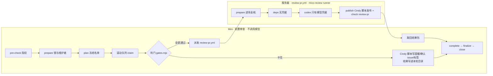

# Mivo 拆分运行胶水

Mivo（`xindong/mivo-canvas-plugin`）的 PR 审查使用 Cindy `review-pr-auto --review-only` 的流程，
拆成两段运行：



| 目录 | 内容 |
|---|---|
| `lib/gates.mjs` | 判门顺序（照 pr-worker：凭证 → 维护者确认门 → thread → 受保护路径/格式/CI/冲突/bot/rebase → 送审）与确认 issue 文案。改界面不进维护者确认门；缺界面证据（截图/录屏或 HTML）由 context 记进格式门打回；「效果展示」第一行写「不涉及」也算过 |
| `lib/scope.mjs` | 增量复审范围（方案第 8 节）：逐文件比较 PR patch，带全量兜底 |
| `lib/report.mjs` | 答卷校验、最终报告、发布前脱敏 |
| `lib/prompt.mjs` | 审查任务书：规范原文取自本仓 `review-pr/SKILL.md` 第 5 节、pr-worker 第 3 节、rule-map |
| `lib/deferrals.mjs` | 审查问题转 issue 跟进：解析 PR 说明里的登记、核验 issue、汇总 |
| `server/review.mjs` | 服务器四阶段：prepare / deps / codex / publish |
| `server/codex.mjs` | Codex CLI 调用：凭据只进 CLI 进程，子进程环境从零构造，产物去掉 key |
| `lib/admission.mjs` | 滚动接单的判断：什么时候另开一轮、哪些 PR 不进新一轮、held PR 什么时候唤醒 |
| `prereview/round.mjs` | Mini 前置审查主流程（一个进程可以同时推进多轮） |
| `prereview/admit-candidates.mjs` | 滚动接单用的候选名单（去掉未完成轮次里的 PR 及依赖它们的 PR） |
| `prereview/gh-dryrun/` | dry-run 模式的 gh 垫片：读放行，写一律拦下 |
| `prereview/install-mini.sh` | 在 Mini 上部署/升级一个实例（launchd 每 180 秒） |
| `config/sandbox-pr-rules.json` | E1 沙箱仓用的配置 |

## 严重度

服务器审查的任务书（`lib/prompt.mjs`）按维护者 2026-10-12 的决定使用统一分级，覆盖 `review-pr/SKILL.md` 第 5 节的「严重度」段：只报确认成立的 P0（大范围灾难性影响）与 P1（受支持场景中可信可达的触发路径导致核心流程失效、严重数据错误或安全/隐私边界被突破）；规范原文里「记 P1」的具体条款按实际影响重新分级，P2/P3 不报、不阻断。

## 审查问题转 issue 跟进

维护者 2026-10-14 决定：审查出的 P1，作者确认本 PR 修不了、要在后续 PR 里修时，可以转成 issue 跟进。登记好以后，这条 P1 不再阻断本 PR；没有别的 P0/P1 时，审查机照常 Approve。P0 不能转。

作者怎么做：

1. 开 issue：写清是哪个问题、现在有什么风险、打算怎么修；标题或正文提到本 PR（`#<PR 号>` 或 PR 链接）。issue 由 PR 作者或维护者开，保持 OPEN。
2. 在 PR 说明里加一节，标题一字不差：`## 转 issue 跟进的审查问题`（`##` 到 `####` 都行）。每个问题一行，写 issue 引用和一句说明，例如 `- #1001 旧 ghost 列表静默漏列`。只认本仓 issue，最多 10 项。
3. 在审查机原来那条讨论里回复 issue 链接，然后 resolve。前置门要求讨论全部 resolve 才送审；只剩审查机自己的 Request Changes、讨论都已 resolve 时，Mini 会对当前 head 重审。

审查机怎么判：

- 服务器 `prepare` 逐条读 issue，只采用同时满足这些条件的：在本仓（没被转移）、是 issue 不是 PR、OPEN、开 issue 的人是 PR 作者或维护者、标题或正文提到本 PR。没采用的写进报告并说明原因。
- 任务书只列采用的 issue。审查模型只能把和它们是同一问题（同一根因、同一触发路径）的 P1 标成 `deferredTo`；对不上或拿不准的照常阻断。`publish` 再核一遍：P0、或 issue 不在采用名单里的，照常阻断。
- 转 issue 的 P1 不开 thread、不阻断。没有其他 P0/P1 时照常 Approve、check `review-pr` 写 success、挂 `review:merge-ready`。报告单列「已转 issue 跟进的问题（不阻断本 PR）」，check 标题写明几条 P1 已转 issue。这不是免审：问题照样写在报告里。
- 打回时，只要阻断问题里有 P1，报告结论下面会附上这套做法。
- issue 关闭或从 PR 说明里删掉登记后就不再算。上一轮有转 issue 的问题时不沿用上一轮结论，每次重审都重新核验；已经发出的 Approve 要等下一次重审才会变。放行后加 `review:merge-ready` 标签会触发一次增量重审，这是已知代价。

## 每天的运维

和老审查机用同一套机制、同一个时间表。两套跑在 L20-1 的同一批 runner 用户上，共用同一个工具目录和同一个 codex 二进制，所以服务器上的定时器是同一份，不另装：

| 时间（Asia/Shanghai） | 动作 | 新审查机怎么配合 |
|---|---|---|
| 06:00 | `mivo-review-close-seats.timer`：marker 改成 unhealthy，等所有 `gha-mivo-review-N` 上在跑的任务退出（新审查机的任务也在里面） | Mini 不开新一轮，也不派新审查；在途的审查跑完 |
| 06:05 | `mivo-review-cli-update.timer`：更新 CLI（sha256 校验、旧版备份、自检、模型探活、失败回滚、写 marker、连续 3 次失败告警） | 共用更新结果 |
| 07:00 | 不调度：时钟出了窗口且 marker 健康就开门 | 服务器 `prepare` 与上模型前各查一次窗口和 marker（对应老 gate 的两次检查）；Mini 07:00 起照常采集，窗口里来的 PR 自动补审 |

判据在 `lib/health.mjs`，逐条照搬 Mivo 的 `.github/scripts/review_tool_health.py`：06:00–06:59 关门；marker `status=healthy` 且有 `run_id` 才放行；缺文件放行；读不到按不健康；超过 26 小时没更新只告警不拦。没通过时，服务器不调模型，这次派发不算一次失败的尝试；工具链不健康时，Mini 暂停派发 30 分钟再试。

## 审查时长与超时

维护者 2026-10-14 决定大 PR 审得深（`lib/models.mjs`）：

| 档位 | 主模型上限 | 备用模型 | 说明 |
|---|---|---|---|
| light | 15 分钟 | 15 分钟 | |
| standard | 45 分钟 | 45 分钟 | 模型合计最多 90 分钟，加上准备和发布，整个作业会更长 |
| heavy | 98 分钟 | 实足 20 分钟以上 | 主模型在 98 分 6 秒被终止时，备用还有 20 分 54 秒 |

- 主备共用一个预算：调模型前按本 job 的真实开始时间（jobs 接口的 `started_at`，读不到就用 run 的 `created_at`）算「作业截止 − 现在 − 10 分钟发布预留」，再与 120 分钟取小。装依赖、扫描、装 semgrep 累计超过 30 分钟时，预算跟着收缩，发布（含产物上传）始终有 10 分钟。两个时间都读不到就不启动模型，本次记 error，由 Mini 按下一节的规则重试。
- 作业上限是 `review-pr.yml` 的 `timeout-minutes`（160），codex 步骤用环境变量 `MIVO_REVIEW_JOB_TIMEOUT_MIN` 传进来；没传时按旧 workflow 的 110 分钟算。
- 每次模型调用在结果包的 `mivo.codex.attempts[]` 里按 JSONL 事件留下记录：`firstEventSec`、`lastEventSec`、`eventCount`、`maxGapSec`（含开始到第一个事件、最后一个事件到退出两段空白）、`usage`（取 `turn.completed`，没有记 null）；失败时另记脱敏后最后 50 行、最多 8 KB 的 `stderrTail`。这些只进结果包，不进 PR 评论，也不能单独当作「变慢原因」的证据。

## 审查失败后怎么重试

规则在 `lib/retry.mjs`，记录在 Mini 状态目录 `reviews.json` 每个 PR 的 `failures`（按 head）。服务器审查失败（`outcome=error`、超时取消、没有结果包、结果对不上）后，同一个 head 等 10 分钟再派，之后每次翻倍，最多等 4 小时；同一个 head 失败满 6 次停止自动重试，派发次数超过 9 次（`review-pr.yml` 守卫的上限）也停。成功一次就清零；作者推新提交是新 head，重新计数。维护窗口与工具链不健康不算失败。被拦住时 Mini 日志写 `retry-held`。

要在不推新提交的情况下重新审：在 Mini 上把该 PR 在 `state/<实例>/mivo/reviews.json` 里的 `failures` 删掉（或删掉对应 head 那一项），下一轮就会派发。

## 并发与滚动接单

- 全进程「在审」（已派发、还没收回结果的服务器 run，GitHub 上 queued 或 in_progress 都算；还不知道有没有派出的派发也算）不超过配置的 `maxParallel`（上限 10）。每次领取任务前都先查全局在审数，满了就不领取。
- 已有轮次在等服务器审查时，每 3 分钟检查一次：先续锁、写心跳、看部署暂停，再判断要不要另开一轮。同时满足下面几条才另开一轮：没有部署暂停、不在 06:00–07:00 维护窗口、没有暂停（`pause.json`）、没有轮次还积压着未领取的任务、有空槽。轮次重叠多久都照常接单（用户 2026-10-14：白天不停接单）。
- 开新一轮前只读比对一次维护者名单（`admit-candidates.mjs --authority-only`，不写快照）；变了就停止接单，手上的跑完退出，launchd 重启时 prepare 写新快照。plan 要跑几分钟，回来后启动这一轮前再查一次锁、skill SHA、维护窗口和部署暂停，任一不满足就不启动，plan 文件留给下次启动恢复。
- 同一个 PR 不会同时进两个未完成的轮次；依赖在审 PR 的 PR（round-state 里的 `dependencyPrs`，按传递关系）一起延后。
- 维护者确认 issue 有新留言（Slack 放行）时，在审 PR 先不唤醒，等它所在那一轮结束后的检查点再唤醒。
- 进入 06:00 维护窗口、检出了新的 skill SHA、维护者名单变化、部署暂停、某一轮失败、接单时 plan 失败，就不再接新轮；手上的轮次跑完就退出，launchd 用新代码重新拉起。运行满 24 小时是保险上限。所有轮次结束时进程本来就会退出，空闲时寿命不变。
- 续锁（`refresh-lock.mjs`）返回不是 `refreshed: true`：锁已不属于本进程。记 `lock-lost`，所有轮次停下，之后不领取、不派发、不取消、不写评论和标签、不写心跳，也不释放锁（那是接管者的），进程非 0 退出，未完成轮次留给持锁者恢复。
- 某一轮失败时，如果它手里还有已派发、没收回的服务器 run，这些槽位没人释放：其余轮次停下、不收尾，整个进程退出，launchd 重新拉起后一起恢复。失败的那一轮手里没有在途 run 时，只停止接新轮，其余轮次照常跑完。
- 中断后下次启动，所有未完成的轮次一起接着跑：先把每一轮已派发的 run 都登记进在审数，再开始领取新任务。
- 日志事件：`plan`（接单开的轮次带 `admitted: true`）、`admit-skip`、`admit-none`、`admit-error`、`admit-plan-error`、`admit-deferred`、`authority-changed`、`admission-closed`、`resume-rounds`、`resume-dispatch`、`round-failed`、`rounds-aborting`、`round-aborted`、`round-quiesced`、`watch-restart`、`wake-held-deferred`、`lock-lost`、`heartbeat-error`；派发与收结果见下面几节。

## 派发落盘与未决派发

派发分四个落盘状态，写在轮次目录的 `dispatch-intent-<PR>.json`：`prepared`（生成了 dispatch_id、还没外发）→ `dispatching`（调 `gh workflow run` 之前）→ `sent`（gh 返回成功）→ `bound`（找到 runId）。

- 中断后恢复时，只有 `prepared`（或没有意图）能证明没外发，按「判门中途断了」收尾，下一轮重新派。`dispatching`、`sent` 一律不自动重发：按 dispatch_id 在意图时间前后分页找 run（不只看最近 30 条），找到就登记；查询失败、列表不完整、暂时看不到，都记 `dispatch-unknown`，照样占一个槽，3 分钟后再查。
- `gh workflow run` 明确被拒（HTTP 4xx 且有错误内容）才算没派出，按失败重试；超时、断线、5xx 都按「不知道有没有派出」处理。派发当时找不到 run 也一样。
- 从意图时间起 60 分钟还找不到：记 `dispatch-unresolved`，巡检提醒人工核对。占槽和这个 PR 的未决记录都保留，作者推新提交也不算解除。
- 人工核对后在 `<stateDir>/mivo/dispatch-resolution-<dispatch_id>.json` 写解除记录，二选一：`{"resolution":"not-submitted"}`（核实没派出：按没派出收尾，不计失败，PR 回到候选）；`{"resolution":"found","runId":"<id>"}`（找到了：只把「不知道」变成「已知是这个 run」，占槽不变，run 结束才释放；run 名不是 `review-pr #<PR> <dispatch_id>` 就忽略，记 `dispatch-resolution-invalid`）。处理顺序：先写进意图文件，再记 `dispatch-resolved`，最后删解除记录；中途被杀，重启后只补后两步。

## 服务器审查的取消线与作者推新提交

- 排队和执行分开计时（`toRunTiming`）：执行超过 170 分钟才取消（作业上限 160 分钟）；排队超过 30 分钟记 `queue-slow`，超过 120 分钟才取消。两种取消都按失败重试。
- 作者在审查中途推了新提交：先在轮次目录写 `cancel-intent-<PR>.json`，再 `gh run cancel`（`cancel-superseded`）。旧 run 确认结束前仍占槽；结束后任务结果写合法终态 `state-changed`，不计失败，派发账本保留；取消没成功、旧 run 自然跑完的，按正常流程收结果。
- 只有「head 已变、旧 run 已确认结束」的 PR 从未完成轮次里提前释放（轮次目录 `mivo-released.json`，`pr-released`），新 head 在下一个检查点进新一轮，不等同轮其它 PR。同 head 的普通结果仍随原轮收尾。
- `reviews.json` 每个 PR 记 `ownerRoundId`（最近一次接走它的轮次）；旧轮晚收尾时不写回已转给新轮的 PR（`store-skip`）。轮次状态的写回保护在 `review-pr/scripts/review-round.mjs`（MIVO-PATCHES 的 round-owner）。
- `collected` 日志带 `head`。

## 部署停点（换版本用）

- 新增 `<stateDir>/mivo/deploy-hold.json`：进程启动时看到它就记 `deploy-hold` 直接退出、不拿锁；在跑的进程不开新轮、不领取、不派发（`dispatch-held`，不算失败），已派出的照常收结果。
- 在审 run 和未决派发都归零后完成停机握手：还没领取的任务留在轮次文件里，用自己的 token 调 `release-lock.mjs`，只有返回 `released: true` 才在 `quiesced.json` 写 `lockReleased: true`（否则写 `false` 和返回内容），正常退出。有未决派发时到不了停点。部署脚本只认这个回执，不对还在跑的进程 `bootout`。

## 心跳

只有生产实例（配置 `instance=mivo` 且 `mode=live`）写：进程启动时（在部署暂停、暂停、维护窗口三处提前返回之前）和每个检查点，距上次超过 15 分钟就 `gh variable set MIVO_PREREVIEW_HEARTBEAT`（UTC 时间），上次写入时间记在状态目录 `heartbeat.json`。写失败只记 `heartbeat-error`；续锁失败后不再写。Mini 之外的看门狗读这个变量。

## 仓库副本的 git 配置

前置调用的 git 都带 `gc.auto=0`、`maintenance.auto=false`、`core.commitGraph=false`（`GIT_CONFIG_*` 环境变量）。两次整轮失败都出在 fetch 刚结束、建工作目录的时刻，最可能是后台 gc 抢了副本（推测，未证实）。手动 gc 放在 06:00–07:00 窗口里做。

## 三种模式

| 模式 | Mini | 服务器 |
|---|---|---|
| `dry-run` | 判门、派发都照做，**任何 GitHub 写入都被垫片拦下**，打算做的动作记在结果的 `dryRunActions` | 完整审查，只上传结果包，不写 PR、不写 check |
| `sandbox` | 对沙箱仓真实写入 | 对沙箱仓真实写入；check `review-pr` 由沙箱仓的检查镜像 workflow 写（`GITHUB_TOKEN` 只能写本仓，见 `lib/checks.mjs`） |
| `live` | 对 Mivo 真实写入 | 发 review、开 thread、写 check `review-pr`、挂 `review:merge-ready` |

服务器允许的最高模式由 Mivo 仓库变量 `MIVO_REVIEW_MODE` 决定。

## 部署

服务器（全部经 GitHub 设置，不登录服务器）：

- 仓库变量：`MIVO_REVIEW_SKILL_SHA`（本仓提交，Mini 与服务器必须一致）、`MIVO_REVIEW_MODE`、
  `MIVO_REVIEW_SANDBOX_REPO`、`MIVO_REVIEW_DAILY_CAP`、`MIVO_REVIEW_RUNNER_LABEL`（切换前 `mivo-review-next`）、
  可选 `MIVO_REVIEW_MODEL_*` / `MIVO_REVIEW_EFFORT_*`；
- secrets：`MIVO_REVIEW_BOT_TOKEN`（发布用）、`LITELLM_CREDENTIALS_JSON`（模型网关）。

Mini：

```bash
bash ~/mivo-prereview/skill/mivo/prereview/install-mini.sh --sha <SHA> --instance mivo \
  --target-repo xindong/mivo-canvas-plugin --mode dry-run --workflow-ref main
```

日志在 `~/Library/Logs/mivo-prereview/<实例>/round-<UTC 日期>.jsonl`，每个事件一行 JSON。
